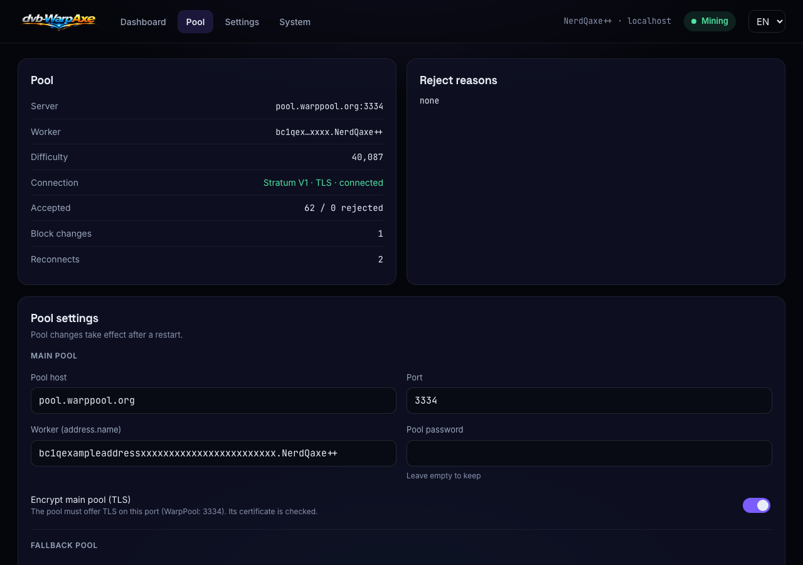
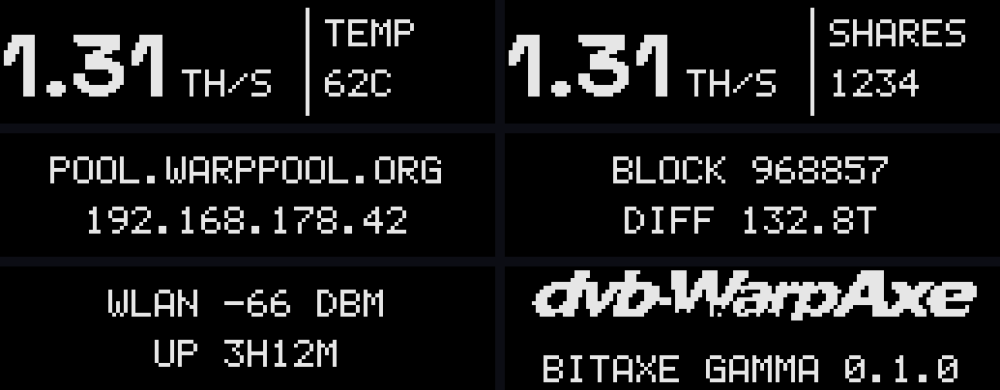

<p align="center">
  
</p>

<p align="center">
  <strong>Open-source Rust firmware for BM1370 Bitcoin miners</strong><br>
  Bitaxe Gamma · NerdQAxe++ · Stratum V1 + TLS · AxeOS-compatible API · Online updates
</p>

<p align="center">
  <a href="LICENSE"></a>
  
  
  
  <a href="https://git.warppool.org/dvb-projekt/dvb-WarpAxe/releases"></a>
</p>

---

dvb-WarpAxe is a from-scratch firmware for ESP32-S3 miners with BM1370
ASICs, written in Rust. It replaces AxeOS (Bitaxe) and NerdOS (NerdQAxe)
on the device and speaks their HTTP API, so dashboards, tuners and fleet
tools that talk to a Bitaxe keep working — including
[WarpTune](https://git.warppool.org/dvb-projekt/dvb-WarpPool), the
clock-and-voltage regulator of dvb-WarpPool.

What it adds on top: Stratum over **TLS** with a checked certificate, a
**fallback pool** that hands back to the main pool on its own, **online
updates** from the release page, a device display with **animated special
screens** (yes, a found block gets a warp jump), a regulator and sensor
layer that rejects implausible readings instead of acting on them, and a
web UI that is the same for the Bitaxe and the Nerd series and shows which
one you are looking at.

The chip protocol, the chain driver and the board drivers are `no_std`
crates that run under `cargo test` against a simulated chain and a scripted
I²C bus, so most of the firmware is tested on a laptop before it touches a
miner.

> **Status: early (v0.1.0).** It mines 24/7 on one Bitaxe Gamma and one
> NerdQAxe++ (Rev 6.1) under WarpTune. Other boards have a profile but have
> not run it — see [Supported boards](#supported-boards) before you flash.

## Screenshots

### Web UI

<p align="center">
  <br>
  <em>Dashboard — type plate with chip grid and series colour, 1 h / 3 h history with hashrate and chip temperature, fans, power and pool.</em>
</p>

<p align="center">
  <br>
  <em>Settings — clock and voltage as the manufacturer's steps; <code>?oc</code> in the address unlocks free values and the expert section (fan PID, second fan output, suggested difficulty, job interval).</em>
</p>

<p align="center">
  <br>
  <em>System — online update from the releases, upload, maintenance (switch the chips off without losing the device, reset overheat) and the live log.</em>
</p>

<p align="center">
  <br>
  <em>Pool — main and fallback pool, each with its own TLS switch; reject reasons and the last reject for diagnosis.</em>
</p>

### Device display

<p align="center">
  <br>
  <em>NerdQAxe++ (320×170 LCD) — the cockpit and three of the four pages the page key steps through (a log page follows). Block height, halving and network difficulty come from the pool's job; the BTC price line appears only if you switch it on.</em>
</p>

<p align="center">
  <br>
  <em>Block found — stars accelerate into a warp jump, a flash, then the height with shock rings until a key is pressed.</em>
</p>

<p align="center">
  <br>
  <em>Special screens — overheat (pulsing frame), chips off, firmware update with progress.</em>
</p>

<p align="center">
  <br>
  <em>Bitaxe Gamma (128×32 OLED) — hashrate large, rotating values, full-width info slides and the wordmark.</em>
</p>

All display images are rendered from the firmware's own drawing code
(`tools/display-preview`) with sample values; a device's screen can be read
back at any time with `GET /api/v1/display/frame`.

## Features

### Mining
- BM1370 chain driver: enumeration, baud switch, PLL solved (not looked up)
  and ramped, work dispatch, nonce attribution, stale and duplicate
  filtering, per-chip silence watchdog.
- Stratum V1 with version rolling (BIP 310), `mining.suggest_difficulty`,
  optional **TLS** (esp-tls, built-in CA bundle, hostname checked).
- **Fallback pool**: after three failed attempts on the main pool; a probe
  every five minutes brings it back as soon as the main pool answers.
- Block height, network difficulty and the pool's coinbase tag read from the
  job; a nonce at or above the network difficulty is reported as a found
  block.

### Board
- Regulators: TPS546 (Bitaxe Gamma), TPS53647/TPS53667 (Nerd boards).
- Sensors and fans: EMC2101, EMC2302 (two outputs), TMP1075, FXL6408 GPIO
  expander.
- Fan PID with ESP-Miner's gains, a second output that follows the regulator
  temperature, minimum speed, polarity.
- Overheat shutdown of the core voltage, a guard for a lost chip sensor
  (60 s blind = off), and plausibility windows for every reading: a
  regulator that answers garbage while it powers up is reported as "no
  reading", never as a value a tuner could act on.
- Switch the chips off and on again from the web UI or the API; the device
  stays reachable.

### Web UI and API
- One UI for every board, series colour and chip grid on the type plate;
  English and German (more languages to come, each with a native-speaker
  review).
- 1 h / 3 h history with hashrate and chip temperature, fan, power and pool
  cards, live log.
- AxeOS/NerdOS-compatible endpoints: `/api/system/info`, `PATCH
  /api/system`, `/api/system/asic`, `/api/v2/settings`, restart, OTA upload.
- WarpAxe's own: `/api/v1/state`, `/api/v1/history`, `/api/v1/log`, chips
  off/on, overheat and best-difficulty reset, Wi-Fi scan, display frame /
  key / demo, online update.

### Device display
- NerdQAxe++ LCD: cockpit with the last hour's hashrate, Bitcoin, device,
  pool and log pages, anti-aliased fonts (Space Grotesk, JetBrains Mono,
  Inter) pre-rendered at build time.
- Bitaxe OLED: large hashrate, rotating values, info slides, share blink.
- Special screens for block found, overheat, chips off and firmware update;
  display language, time zone, screen timeout.
- Optional BTC price and fee rates from mempool.space — **off by default**;
  with it off the miner talks to its pool and nothing else (plus the update
  check, which you can switch off too).

### Updates
- **Online update**: the miner checks this repository's releases at start
  and every 12 hours, the web UI shows the new version and its notes, and
  one click downloads, verifies (SHA-256) and installs it. Nothing installs
  by itself: an update restarts the miner.
- Upload a `warpaxe.bin` in the web UI, or `curl --data-binary @warpaxe.bin
  http://<miner>/api/system/OTA`.
- The web UI and its fonts are part of the image: one file, one update.

## Supported boards

| Board | ASICs | Regulator | Status |
|---|---|---|---|
| Bitaxe Gamma (601/602) | 1× BM1370 | TPS546 | **runs 24/7** |
| NerdQAxe++ Rev 6.1 | 4× BM1370 | TPS53647 | **runs 24/7** |
| NerdOctaxe Gamma | 8× BM1370 | TPS53667 | profile only, not run yet |
| NerdAxe Gamma | 1× BM1370 | TPS546 | profile only, not run yet |
| NerdQX (Q1370 / Q1373) | 4× BM1370 / BM1373 | TPS53647 | profile only, not run yet |

Boards marked "profile only" have pins, regulator window and limits taken
from their stock firmware, but nobody has run WarpAxe on one yet. Please
don't flash them unless you can recover the stock firmware over USB.

## Install

**First install** is still a developer step: it needs a USB cable and the
ESP toolchain, and the board model has to be set in the configuration
before the first boot. A guided first install (board choice on first
start) is on the list.

1. **Back up the stock firmware** — `tools/flash-backup.sh` reads the whole
   flash (16 MB) over USB, so you can always go back.
2. Build and flash (see [Build from source](#build-from-source)); set
   `boardModel` (`bitaxe-gamma`, `nerdqaxe-plusplus`, …), Wi-Fi and pool in
   the configuration.
3. Open the web UI at the miner's address — or, on boards with native USB,
   at `http://192.168.7.1` over the USB cable (the miner shows up as a USB
   network adapter).

**Updates** after that come from the web UI: *System → Online update →
Install*, or upload `warpaxe.bin` from the
[releases page](https://git.warppool.org/dvb-projekt/dvb-WarpAxe/releases).
Every release carries `warpaxe.bin` (one image for all boards — the board is
configuration) and `warpaxe.bin.sha256`.

## Build from source

Host crates and tests:

```bash
cargo test --workspace
cargo clippy --workspace --all-targets -- -D warnings
cargo build -p warpaxe-core --target thumbv7em-none-eabihf   # proves no_std
```

Firmware (Xtensa, ESP-IDF 5.3 via `esp-idf-svc`; toolchain from
[espup](https://github.com/esp-rs/espup)):

```bash
cd firmware/warpaxe
cargo build --release
espflash save-image --chip esp32s3 --flash-size 16mb \
    target/xtensa-esp32s3-espidf/release/warpaxe warpaxe.bin   # OTA image
espflash flash --partition-table partitions.csv \
    target/xtensa-esp32s3-espidf/release/warpaxe                # first install over USB
```

Display preview on the host (every page, special screen and OLED slide as
PNG, from the firmware's own drawing code):

```bash
cargo run --release --manifest-path tools/display-preview/Cargo.toml -- /tmp/frames
for f in /tmp/frames/*.raw; do python3 tools/frame2png.py "$f" "${f%.raw}.png"; done
```

Fonts and the splash are generated from `tools/fonts` (SIL Open Font
License) and `docs/brand` by `tools/make-fonts.py` and
`tools/make-splash.py`; releases are published with
`tools/release-firmware.sh`.

## Repository

| Path | What |
|---|---|
| `crates/core` | BM13xx wire protocol: frames, CRCs, decoders, PLL solver, register payloads, chip profiles with the init sequence as data — `no_std`, no alloc |
| `crates/chain` | the chain driver over a `Uart` trait — `no_std`, the code the firmware runs |
| `crates/board` | regulators, sensors, fans, fan PID, OLED, board profiles over an `I2c` trait — `no_std`, tested against a scripted bus |
| `crates/stratum` | Stratum V1 without sockets: messages, jobs, coinbase reading, tested against a captured WarpPool session |
| `crates/sim`, `crates/simuart` | a simulated BM1370 chain and board with fault injection |
| `crates/axeos`, `crates/cgminer` | AxeOS- and cgminer-compatible devices on top of the simulator, for testing tuners |
| `crates/scenarios` | WarpTune's regulator in-process against the simulated devices (git dependency on dvb-WarpPool) |
| `firmware/warpaxe` | the ESP32-S3 firmware: Wi-Fi and USB networking, Stratum, miner, board, web UI, display, updates |
| `tools/` | font and splash generators, display preview, flash backup, release script |

Run the simulated AxeOS device, for example to test a tuner:

```bash
cargo run --release -p warpaxe-axeos -- --port 8811 --time-scale 30
curl -s http://127.0.0.1:8811/api/system/info | jq .
curl -s -X POST -d '{"board":{"SilentVrShutdown":{"above_hz":600000000}}}' http://127.0.0.1:8811/sim/fault
```

## Design

- [`docs/00-Design-BM1370.md`](docs/00-Design-BM1370.md) — architecture,
  chip profiles, PLL, simulator, findings, the transport decision
  (USB-NCM + USB bridge) and the firmware's operating notes;
- [`docs/01-Benefit-for-WarpTune.md`](docs/01-Benefit-for-WarpTune.md) — what
  this buys WarpTune, concretely;
- [`docs/02-Demo-WarpTune-vs-Sim-2026-09-23.txt`](docs/02-Demo-WarpTune-vs-Sim-2026-09-23.txt)
  — the first run of WarpTune against the emulator, unedited.

Short version: registers and init sequences are **data**, not code per
chip; the PLL is **solved**, so the reported frequency is the real one;
and the simulator exists to make field failures reproducible — including
the one that started this project, a regulator that shut down silently
while the stock firmware kept reporting full hashrate.

## Provenance

The BM1370/BM1373 have no public datasheet. What is known comes from
reverse engineering, chiefly [ESP-Miner](https://github.com/bitaxeorg/ESP-Miner)
(GPL-3.0) and, for the Nerd boards,
[ESP-Miner-NerdQAxePlus](https://github.com/shufps/ESP-Miner-NerdQAxePlus)
(GPL-3.0). Every constant lifted from there says so in its doc comment;
every test vector says where it came from. The Bitcoin whitepaper served by
the firmware is Satoshi Nakamoto's `bitcoin.pdf` (SHA-256
`b1674191…f553`).

## License

GPL-3.0-or-later (see [LICENSE](LICENSE)), for the reason above. The fonts
in `tools/fonts` are under the SIL Open Font License.
