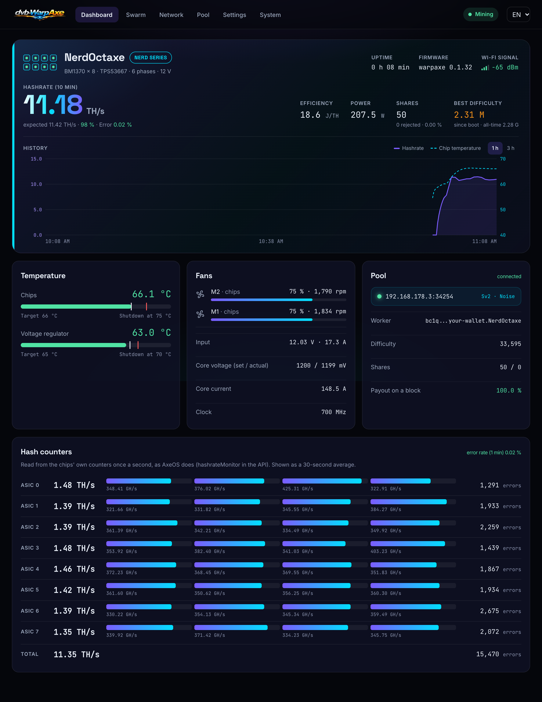
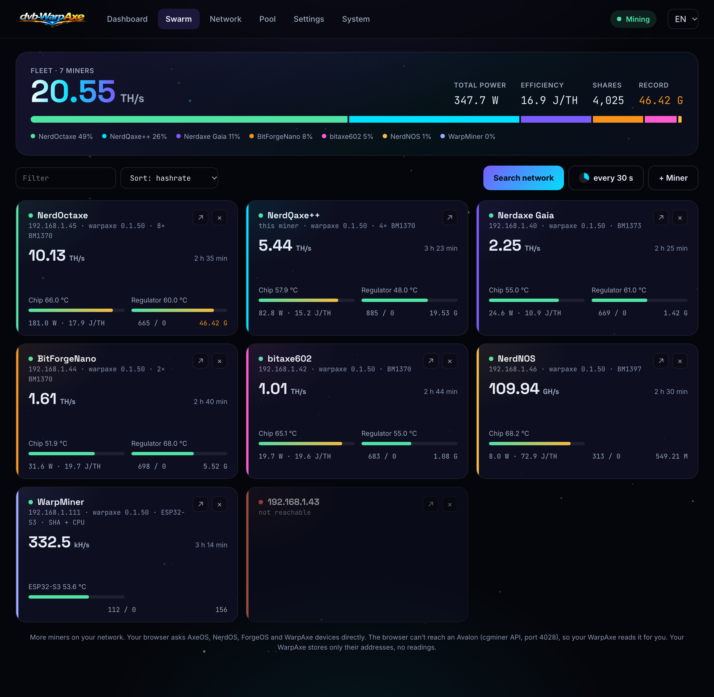
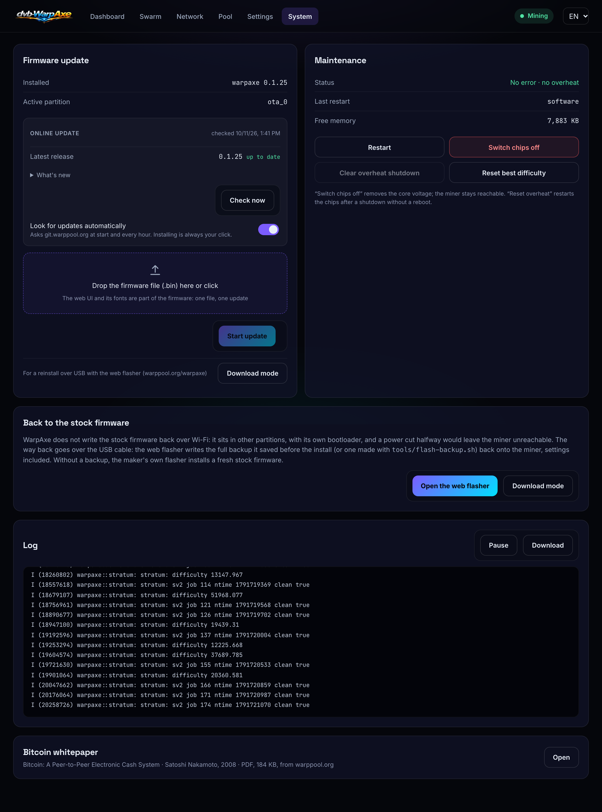
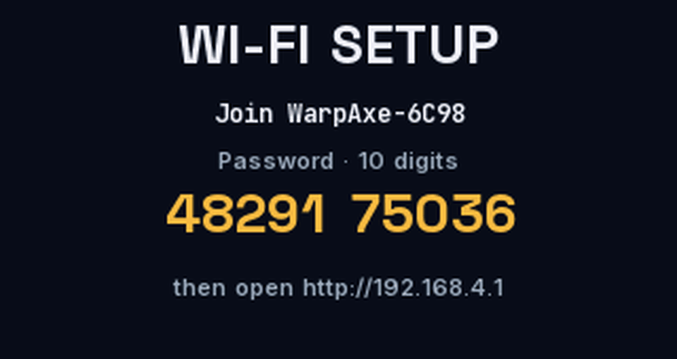
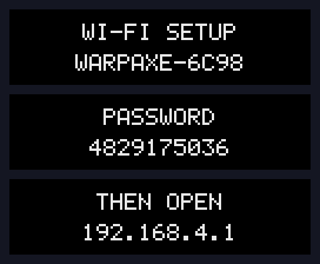

<p align="center">
  
</p>

<p align="center">
  <strong>Open-source Rust firmware for BM1370 and BM1373 Bitcoin miners</strong><br>
  Runs on Bitaxe Gamma · NerdQAxe++ · NerdOCTAXE-γ · NerdAxe Gaia · BitForge Nano<br>
  <a href="#supported-boards">profiles for 7 more boards</a> · Stratum V1 + V2 · AxeOS-compatible API · Signed online updates
</p>

<p align="center">
  <a href="LICENSE"></a>
  
  
  
  <a href="https://git.warppool.org/dvb-projekt/dvb-WarpAxe/releases"></a>
</p>

---

dvb-WarpAxe is a from-scratch firmware for ESP32-S3 miners with BM1370
and BM1373 ASICs, written in Rust. It replaces AxeOS (Bitaxe), NerdOS (the
Nerd boards) and ForgeOS (BitForge Nano) on the device and speaks their
HTTP API, so dashboards, tuners and fleet tools that talk to a Bitaxe keep
working — including
[WarpTune](https://git.warppool.org/dvb-projekt/dvb-WarpPool), the
clock-and-voltage regulator of dvb-WarpPool.

It does what the stock firmware does — Stratum V2 with the pool's
authority key checked, Stratum V1 over TLS, a fallback pool that hands back
to the main pool — and differs where it counts for running a fleet:
**signed online updates** the miner fetches and checks itself, **one image
for every board** with the board found on the first start and Wi-Fi and
pool taken over from the previous AxeOS/NerdOS settings, a
**password-protected setup hotspot** when there is no network to join, a
regulator and sensor layer that **rejects implausible readings** instead of
acting on them, the web UI **over the USB cable** as well as over Wi-Fi, and one web
UI in eight languages for the Bitaxe and the Nerd series. The device
display has animated special screens (yes, a found block gets a warp jump).
See [Compared with the stock firmware](#compared-with-the-stock-firmware)
for where it is ahead and where it is not.

The chip protocol, the chain driver and the board drivers are `no_std`
crates that run under `cargo test` against a simulated chain and a scripted
I²C bus, so most of the firmware is tested on a laptop before it touches a
miner.

> **Status: early (v0.1.17).** It mines 24/7 under WarpTune on five
> boards, one of each: Bitaxe Gamma (since 25 September), NerdQAxe++ (Rev
> 6.1, on Stratum V2), NerdOCTAXE-γ (Rev 3.1, 6-phase regulator, since 28
> September), NerdAxe Gaia and BitForge Nano (since 29 September). Seven
> more boards have a profile; of these the Bitaxe Gamma Duo and Gamma
> Turbo have run it at a user's, as has a NerdOCTAXE-γ v2.2 with the
> 4-phase regulator — see [Supported boards](#supported-boards) before you
> flash.

## Compared with the stock firmware

As of 2026-09-28, against [ESP-Miner/AxeOS](https://github.com/bitaxeorg/ESP-Miner)
v2.15.3 and [ESP-Miner-NerdQAxePlus](https://github.com/shufps/ESP-Miner-NerdQAxePlus)
(NerdOS) v1.1.0.1, from their source. Both move fast; corrections welcome.

| | AxeOS | NerdOS | WarpAxe |
|---|---|---|---|
| Stratum V2 (Noise, authority key, "require authentication") | yes | yes | yes |
| Stratum V1 over TLS, certificate checked | yes | yes | yes |
| Fallback pool, back to the main pool on its own | yes | yes (plus dual-pool mode) | yes |
| Update: miner fetches the release itself | no (download, then upload) | yes (from GitHub) | yes (from the release page, install on a click) |
| Update image signature-checked before flashing | no | no | **yes** (BIP-340, key built into the firmware) |
| Images | factory image per board version (update image shared) | one per board | **one for all boards** |
| Board | set in NVS at the factory | per image | **found on the first start** (factory NVS, read-only I²C probe) |
| Settings on an update or reinstall | kept on online update; web flasher can keep them | kept with the update's "keep settings" option | kept on online update and web-flasher reinstall; **taken over from AxeOS/NerdOS** when switching (Wi-Fi, pools — also AxeOS 2.15's —, hostname, clock and voltage, fans and temperature limits, display) |
| Back on after an overheat stop | yes (≥ 30 s, regulator 10 °C cooler) | not found | yes (≥ 60 s, chip and regulator 10 °C cooler; the third stop within an hour stays off) |
| Regulator fault (PMBus STATUS_WORD) | reported (`power_fault`), no reaction | read once at init, logged | **reported** (`power_fault` with codes, display and web UI) **and treated like an overheat stop**: core voltage off, faults cleared and retried after a minute, the third within an hour stays off |
| Wi-Fi setup without a network | open hotspot (`Bitaxe_XXXX`), or Bluetooth | open hotspot (`Nerdaxe_XXXX`) | **WPA2 hotspot**, password shown only on the device display |
| Implausible sensor/regulator readings | partly ignored (fan loop) | not found | **rejected** before the control loops see them |
| Chip hash counters (per chip, per domain, errors) | yes (`hashrateMonitor`; on the BM1373 four of eight domains, doubled) | total only | yes, AxeOS's fields plus a one-minute error rate; **all eight BM1373 domains** |
| Web UI over the USB cable | not found | not found | **yes** (USB network adapter, `192.168.7.1`) |
| Web UI languages | English | 9 | 8 |
| Language, tests | C | C++/C | Rust; chip, chain and board drivers host-tested against a simulated chain and I²C bus |
| Supported boards | ~20 board versions | 11 boards | 5 run, 7 more with a profile (see below) |

Where the stock firmware is ahead: far more boards and years of use by a
large community; AxeOS has a scoreboard, themes, the BAP accessory port
and Wi-Fi setup over Bluetooth; NerdOS has two-factor login for updates,
dual-pool mining, InfluxDB/Grafana export and alerts. WarpAxe is early; if
you need any of that,
stay with the stock firmware.

## With WarpTune

[WarpTune](https://git.warppool.org/dvb-projekt/dvb-WarpPool/src/branch/main/scripts/warptune-setup.md#what-each-firmware-gives-warptune),
the clock-and-voltage regulator of dvb-WarpPool, works on the stock
firmware in full — it talks the AxeOS API, and WarpAxe keeps that API. The
difference is what the firmware says about itself: WarpAxe reports these
states explicitly, so WarpTune does not have to guess them from the power
draw:

- **Overheat stop**: `overheat_mode` while it lasts, `overheatTrips` and
  `overheatCause` (hot, a lost sensor, or a regulator fault: `power`, with
  the conditions in `powerFaultCodes`). WarpTune holds during the stop,
  and after a hot stop takes the clock one step down (two from the second
  stop in an hour); a lost sensor is no reason to step down.
- **Chips off or the chain still coming up**: `chainStopped` and
  `chainPhase`, so a chain that is powering up is not taken for a dead chip.
- **Fallback pool** and **reject reasons**, as on current AxeOS.
- **Chip error rate over a minute** (`errorPercentage1m`), from the chips'
  own counters: a voltage that is too low shows in minutes, not after
  hundreds of pool shares.

The table on the WarpPool side lists, firmware by firmware, what WarpTune
gets from AxeOS, NerdOS, ForgeOS and WarpAxe.

## Screenshots

### Web UI

<p align="center">
  <br>
  <em>Dashboard — chip grid and series colour, the hashrate with its share of the expected rate, efficiency, power, shares and best difficulty, the 1 h / 3 h history; below, temperature, fans and power, and the pool with the payout of a found block; at the bottom the hash counters per chip and domain (off by default, switched on in Settings).</em>
</p>

<p align="center">
  <br>
  <em>Swarm — every miner on the network, WarpAxe or stock firmware, read by your browser: the fleet's hashrate and each miner's share of it, sparklines, chip and regulator temperatures against their limits.</em>
</p>

<p align="center">
  <br>
  <em>Settings — clock and voltage as the manufacturer's steps, fans (on the Nerd boards both linked to the chips by default), display, and the dashboard's hash-counter card (Wi-Fi, hostname and time are on their own Network tab); <code>?oc</code> in the address unlocks free values and the expert section (fan PID, second fan output, suggested difficulty, job interval).</em>
</p>

<p align="center">
  <br>
  <em>Network — Wi-Fi with a list of networks found, hostname, time by NTP and time zone.</em>
</p>

<p align="center">
  <br>
  <em>System — online update from the releases, upload, download mode for a reinstall with the web flasher, maintenance (switch the chips off without losing the device, reset overheat), the way back to the stock firmware and the live log.</em>
</p>

<p align="center">
  <br>
  <em>Pool — the connection (protocol, Noise/TLS, fallback), shares with reject reasons, and who a found block pays: your share, the coinbase value and each output. Below, main and fallback pool, each Stratum V1 with optional TLS or Stratum V2 with the pool's authority key.</em>
</p>

### Device display

<p align="center">
  <br>
  <em>NerdQAxe++ (320×170 LCD) — the cockpit and three of the four pages the page key steps through (a log page follows). Block height, halving and network difficulty come from the pool's job; the BTC price line appears only if you switch it on.</em>
</p>

<p align="center">
  <br>
  <em>Block found — stars accelerate into a warp jump, a flash, then the height with shock rings until a key is pressed.</em>
</p>

<p align="center">
  <br>
  <em>Special screens — overheat (pulsing frame), chips off, firmware update with progress.</em>
</p>

<p align="center">
  
  <br>
  <em>Setup hotspot — name and password (new at every start, example shown) on the LCD; on the OLED they take turns with the address.</em>
</p>

<p align="center">
  <br>
  <em>Bitaxe Gamma (128×32 OLED) — hashrate large, rotating values, full-width info slides and the wordmark.</em>
</p>

All display images are rendered from the firmware's own drawing code
(`tools/display-preview`) with sample values; a device's screen can be read
back at any time with `GET /api/v1/display/frame`.

## Features

### Mining
- BM1370 and BM1373 chain driver: enumeration, baud switch, PLL solved
  (not looked up) and ramped, work dispatch paced per board as its stock
  firmware does, nonce attribution, stale and duplicate filtering, per-chip
  silence watchdog.
- **Stratum V2** per pool: Noise handshake (secp256k1 + EllSwift,
  ChaCha20-Poly1305), extended channel, the pool's certificate checked
  against its authority key (Base58Check, as pools publish it). "Require
  pool authentication" is on by default: without a key, or before the clock
  is set by NTP, there is no connection. The TLS switch applies to V1 only;
  V2 is always encrypted. The display shows "V2" with the lock. Settings
  from NerdOS (`sv2_proto`, `sv2_auth_pk`, `sv2_reqauth`) are taken over on
  the first start.
- Stratum V1 with version rolling (BIP 310), `mining.suggest_difficulty`,
  optional **TLS** (esp-tls, built-in CA bundle, hostname checked).
- **Fallback pool**: after three failed attempts on the main pool; a probe
  every five minutes brings it back as soon as the main pool answers.
- The Wi-Fi radio stays awake (no modem sleep), so a new job from the
  pool does not wait for the access point's next beacon (~100 ms).
- Block height, network difficulty and the pool's coinbase tag read from the
  job; a nonce at or above the network difficulty is reported as a found
  block.

### Board
- Regulators: TPS546 (Bitaxe boards, NerdAxe Gamma and Gaia, NerdQAxe++
  Rev 7, BitForge Nano), TPS53647/TPS53667 (NerdQAxe++, NerdOctaxe,
  NerdQX); the core current and the regulator's warning line in the API
  where the regulator reports them.
- Never a core voltage below the regulator's clean range: the TPS546
  driver refuses anything under 0.25 V ÷ VOUT_SCALE_LOOP (TI's reference
  range), the API refuses it with 400 and publishes the floor as
  `regulatorMinMv`, and a request the regulator turned down is shown as
  `coreVoltageRefused` instead of counting as applied. The NerdAxe Gaia
  runs on the 0.5 divider (clean 0.5–1.5 V) so its 800–970 mV lie inside
  it — the divider the board's own straps set at power-up; the stock
  firmware's 0.25 put them below. `vrProbe` shows what the regulator held
  at boot, before the firmware wrote it.
- Sensors and fans: EMC2101, EMC2103, EMC2302 (two outputs), TMP1075,
  INA260 (BitForge Nano), FXL6408 GPIO expander.
- Fan PID with ESP-Miner's gains; a second output linked to the chip fan
  by default, as on NerdOS (*Link the fans* off: it follows the regulator
  temperature instead, for a fan that cools only the regulator); minimum
  speed, polarity. After the core voltage comes on — at start and after an
  overheat stop — the fans stay at full until the chips are near their
  target, then the PID takes over from there instead of running them down
  on a cold board. Boards with one fan for chip and regulator (NerdAxe) run it for
  whichever of the two needs more (regulator target 80 °C).
- Overheat shutdown of the core voltage and a guard for a lost chip sensor
  (60 s blind = off, once the chip temperature has been read; a board whose
  chip sensor never answers runs like NerdOS, on the regulator limit with
  the fans at full, and says so in the log). The chips start again on their own once chip and
  regulator are 10 °C below their limits (at least 60 s off; after a lost
  sensor only with real readings back); the third stop within an hour stays
  off until it is cleared by hand.
- Plausibility windows for every reading: a
  regulator that answers garbage while it powers up is reported as "no
  reading", never as a value a tuner could act on.
- Switch the chips off and on again from the web UI or the API; the device
  stays reachable.

### Web UI and API
- One UI for every board, series colour and chip grid on the type plate;
  English, German, Spanish, French, Italian, Brazilian Portuguese,
  Japanese and Chinese, each reviewed by a native speaker (the device
  display in the six Latin-script ones).
- Dashboard and Pool page in the warp design: one hero with the hashrate,
  its share of the expected rate and the 1 h / 3 h history (hashrate as a
  two-minute average, temperature in steps of at least 0.5 °C, so counting
  noise does not fill the chart), then temperature, fan/power and pool
  instruments; live log. Optional (*Settings → Dashboard*, off by default):
  the hash counters per chip and domain, a weak domain marked in colour,
  and the error rate over the last minute. The BM1373 has eight hash
  domains, not four: WarpAxe reads all eight counters (0x88–0x8B and
  0xAC–0xAF), where AxeOS reads four and doubles them. Its error rate runs
  higher than the BM1370's (about 2.5 % on a NerdAxe Gaia at its hand
  point, rising steeply at low core voltage) and is shown without a colour.
- **Coinbase payout** of every job, as AxeOS shows it: the share of a found
  block that goes to your address (green from 95 %, red below), the
  coinbase value and its outputs, over Stratum V1 and V2.
- **Swarm** page for the other miners on the network — AxeOS, NerdOS,
  ForgeOS or WarpAxe: fleet hashrate, power, J/TH and record difficulty,
  each miner's share, a card per miner with a sparkline and its
  temperatures. The browser reads every miner's `/api/system/info` directly
  (every 30 s by default, not while the tab is hidden, one request per
  miner at a time); this miner stores only the address list. Read-only: it
  never changes or restarts another miner. Add miners by address or by a
  search of the local /24.
- Tabs in the stock order: Dashboard, Swarm, Network, Pool, Settings,
  System; the starfield background of dvb-WarpPool. The browser tab names
  the miner ("NerdAxe Gaia · WarpAxe"), so several open tabs tell their
  miners apart.
- AxeOS/NerdOS-compatible endpoints: `/api/system/info`, `PATCH
  /api/system`, `/api/system/asic`, `/api/v2/settings`, restart, OTA upload.
- WarpAxe's own: `/api/v1/state`, `/api/v1/history`, `/api/v1/log`, chips
  off/on, overheat and best-difficulty reset, Wi-Fi scan, display frame /
  key / demo, online update, download mode for the web flasher, the swarm
  list (`/api/v1/swarm`), the last crash's core dump
  (`GET /api/v1/coredump`, an ELF for `espcoredump.py`; `DELETE` erases it),
  and for diagnosis a read-only chip register scan
  (`/api/v1/chip/regs?chip=0&from=0x80&to=0xbf`) and the nonces per core
  (`/api/v1/chip/cores`).
- States a tuner would otherwise have to guess from the power draw are in
  `/api/system/info`: `chainStopped` and `chainPhase`, `overheat_mode`,
  `overheatTrips` (stops in the last hour), `overheatCause` (hot, a lost
  sensor or a regulator fault), `overheatLatched`, `power_fault` (AxeOS's
  field and wording) with `powerFaultCodes`, `isUsingFallbackStratum` (also as NerdOS's
  `stratum.usingFallback`),
  `sharesRejectedReasons`, AxeOS's `coinbaseOutputs`,
  `coinbaseValueTotalSatoshis` and `coinbaseValueUserSatoshis`,
  `temptarget` (the fan target, under ESP-Miner's name) so a tuner keeps
  its own target above it, `coreCurrentA` with `coreCurrentWarnA`,
  `faultCause` (why the regulator stopped), `regulatorMinMv` and
  `coreVoltageRefused` (the regulator's floor and a request it refused),
  `vrProbe` (the regulator's window as found at boot),
  `silentChips`, `chainSilentRestarts` and `chainSilentRestartsSameMv`
  (chips without nonces, and chain restarts after a silent minute — in
  all, and in a row at the current core voltage: two or more mean the
  chips do not run at it), `gitHash` (the commit the
  image was built from), and AxeOS's `hashrateMonitor` (per chip the
  hashrate from the chip's own counters, its domains — four, eight on the
  BM1373 — and the error counter, read once a second) with
  `errorPercentage` (AxeOS's per-second
  value) and `errorPercentage1m` (over the last full minute, for tuners).
- **Setup hotspot**: with no network in the settings, or none reached within
  three minutes of a start, the miner opens `WarpAxe-XXXX` — WPA2, with a
  ten-digit password made at every start and shown only on the device
  display. A phone that joins it gets the Wi-Fi setup page by itself
  (captive portal); after saving, the miner restarts, joins the network and
  closes the hotspot. The log names the address behind every restart,
  download-mode and overheat-reset request.

### Device display
- 320×170 LCD (Nerd boards, Bitaxe Naja Duo and Gamma Hex): cockpit with
  the last hour's hashrate, Bitcoin, device, pool and log pages,
  anti-aliased fonts (Space Grotesk, JetBrains Mono, Inter) pre-rendered at
  build time.
- Bitaxe OLED: large hashrate, rotating values, info slides, share blink.
- Boot screen: the WarpAxe logo, and on the colour-display boards the
  maker's wordmark under it (NerdQAxe++, NerdOctaxe, NerdAxe Gamma, NerdQX,
  NerdAxe Gaia, Bitaxe Naja Duo and Gamma Hex), shown with the makers'
  consent; the small-OLED Bitaxes show the model name instead.
- Special screens for block found, overheat, chips off and firmware update;
  display language, time zone, screen timeout.
- Optional BTC price and fee rates from mempool.space — **off by default**;
  with it off the miner talks to its pool and nothing else (plus the update
  check, which you can switch off too).

### Updates
- **Online update**: the miner checks this repository's releases at start
  and every hour, the web UI shows the new version and its notes (and a
  pill in the header on every page), and
  one click downloads, verifies (SHA-256 and the release signature: BIP-340
  Schnorr with the key built into the firmware, `warpaxe.bin.sig`) and
  installs it. A release without a signature still installs for now and is
  marked as unsigned; that tolerance ends once every release carries one.
  Nothing installs by itself: an update restarts the miner.
- **Chips off before every restart**: an update, a restart and download
  mode first switch the core voltage off and hold the chips in reset, and
  every boot does so before anything else. A TPS546 keeps its output on
  through an ESP reset, so the chips would otherwise sit powered and
  unwatched — a BitForge Nano reached 82 °C (regulator 95 °C) after three
  minutes in download mode.
- **Back to the stock firmware**: *System → Back to the stock firmware*
  explains the way (over USB, with the backup the web flasher saved) and
  opens the flasher's restore section.
- Downloads are tried up to three times; the log names the address that
  started an install, an upload or an update check, and the last install
  (version and signature result) is kept across the restart.
- Upload a `warpaxe.bin` in the web UI, or `curl --data-binary @warpaxe.bin
  http://<miner>/api/system/OTA` — a manual upload is your own image and is
  not signature-checked.
- The web UI and its fonts are part of the image: one file, one update.

## Supported boards

| Board | ASICs | Regulator | Status |
|---|---|---|---|
| Bitaxe Gamma (601/602) | 1× BM1370 | TPS546 | **runs 24/7** |
| NerdQAxe++ (every revision but Rev 7; NerdOS treats them alike) | 4× BM1370 | TPS53647 | **runs 24/7** (on a Rev 6.1) |
| NerdQAxe++ Rev 7 | 4× BM1370 | TPS546 (two voltage domains) | profile from NerdOS, recognised on the bus and offered for one click; not run yet |
| NerdOCTAXE-γ Rev 3.1 | 8× BM1370 | TPS53667 (6-phase) | **runs** since 2026-09-28; at 700 MHz / 1210 mV the pool counts 11.59 TH/s ± 2.5 % (NerdOS: 11.71) since v0.1.9 paces work as NerdOS does; a v2.2 board with the 4-phase TPS53647 runs at a user's since 2026-10-01 (it overheated until its second fan was linked to the chip fan, now the default) |
| BitForge Nano (800) | 2× BM1370 | TPS546 + INA260 | **runs** since 2026-09-29 (ForgeOS's Standard preset 525 MHz / 1150 mV: 2.19 TH/s at 43–45 W; Max 625 MHz / 1160 mV: 2.53 TH/s); offered on the first start, never taken on its own |
| Bitaxe Gamma Duo (650) | 2× BM1370 | TPS546 | profile; runs at a user's since 2026-09-30 (v0.1.10), not on our bench; free clock values with `?oc` as on the Gamma |
| Bitaxe Gamma Turbo (801) | 2× BM1370 | 2× TPS546 | profile; runs at a user's since 2026-10-01 (v0.1.11), not on our bench (a pair at 850 MHz / 1250 mV under AXP90 coolers); free clock values with `?oc` as on the Gamma |
| Bitaxe Naja Duo (1201) | 2× BM1373 | 2× TPS546 (two domains) | profile only, not run yet; free values up to 600 MHz, the maker's documented overclock (600 MHz / 1120 mV, untested by us) |
| Bitaxe Gamma Hex (1300) | 6× BM1370 | 4× TPS546 (two domains) | profile only, not run yet |
| NerdAxe Gamma | 1× BM1370 | TPS546 | profile only, not run yet |
| NerdAxe Gaia | 1× BM1373 | TPS546 (12 V) | **runs** since 2026-09-29; at 420 MHz / 960 mV the pool counts 102 % of the expected rate, as with its stock firmware, but the core then draws 31–33 A against the regulator's 33 A limit, so ours runs at 400 MHz; clock and voltage capped at 420 MHz / 970 mV; since v0.1.16 its regulator runs in the range the board is strapped for (0.5–1.5 V) |
| NerdQX (Q1370 / Q1373) | 4× BM1370 / BM1373 | TPS53647 | profile only, not run yet |

Boards marked "profile only" have pins, regulator window and limits taken
from their stock firmware, but nobody has run WarpAxe on one yet. Please
don't flash them unless you can recover the stock firmware over USB.

## Install

**First install** needs a USB cable once; after that the miner sets itself
up and updates itself:

1. **Keep a way back** — the web flasher saves the miner's whole flash
   (16 MB: stock firmware and settings) into a file you choose before it
   writes anything (on by default, about 2½ minutes, every block checked
   against the chip), and its *Restore a backup* section puts such a file
   back. Without the browser, `tools/flash-backup.sh` does the same with
   esptool. Or keep the stock firmware at hand (the
   [Bitaxe](https://bitaxeorg.github.io/bitaxe-web-flasher/) and
   [NerdQAxe](https://shufps.github.io/nerdqaxe-web-flasher/) web flashers
   put it back; for the other boards, the maker's own flasher or image).
2. Install WarpAxe from the browser with the **web flasher at
   [warppool.org/warpaxe](https://warppool.org/warpaxe/)** (Chrome or Edge
   on a computer). It writes bootloader, partition table and app and
   leaves the settings partition alone, so WarpAxe reads what AxeOS or
   NerdOS left there; it checks every part against the flash and restarts
   the miner when it is done. The flasher serves the current release; its
   image carries the same signature the online update checks. Coming from
   the stock firmware, the flasher usually puts the miner into download
   mode by itself; otherwise hold BOOT, press RST, release BOOT (on a miner
   that already runs WarpAxe: *System → Download mode*). A miner that
   stays dark after a cancelled install is still in download mode: take it
   off power completely — power supply **and** USB cable — for a few
   seconds. Without a browser: `warpaxe-factory.bin` from the
   release at offset 0 with esptool (this one starts with empty settings),
   or [Build from source](#build-from-source).
3. On the first start WarpAxe takes **Wi-Fi, pools, hostname, clock and
   voltage, fan settings, temperature limits and display orientation** from
   the previous firmware (not the fan PID gains, which belong to its own
   loop) and finds the **board**: from the model AxeOS stored at
   the factory, or from the chips that answer on the board's I²C bus
   (read-only probes on pins that switch nothing). A board found for sure
   (a Bitaxe Gamma, for instance) starts mining at once. Otherwise — the
   NerdQAxe++ and the NerdOctaxe look alike on the bus, and a board that
   has never run WarpAxe is only offered — the web UI asks once which board
   it is, and the chips stay off until you answer. A core rail the stock
   firmware left on is switched off meanwhile; the display already runs,
   so the setup hotspot's name and password show while you choose.
4. Open the web UI at the miner's address — or, on boards with native USB,
   at `http://192.168.7.1` over the USB cable (the miner shows up as a USB
   network adapter). If there was no Wi-Fi to take over, or it cannot be
   reached, the miner opens its setup hotspot after three minutes: join
   `WarpAxe-XXXX` with the password on its display and choose your network.

**Updates** after that come from the web UI: *System → Online update →
Install* (a bar under the header follows it on every page and says when
the miner is back on the new version), or upload `warpaxe.bin` from the
[releases page](https://git.warppool.org/dvb-projekt/dvb-WarpAxe/releases).
Every release carries `warpaxe.bin` (one image for all boards — the board is
configuration), `warpaxe.bin.sha256` and `warpaxe.bin.sig`; for the first
install also `warpaxe-factory.bin` (bootloader, partition table and app in
one image) and `web-flasher.tar.gz` (the web flasher as published), with
their checksums in `install.sha256`. `tools/verify-release.py` checks an
image's signature without the Rust toolchain.

## Build from source

Host crates and tests:

```bash
cargo test --workspace
cargo clippy --workspace --all-targets -- -D warnings
cargo build -p warpaxe-core -p warpaxe-chain -p warpaxe-board \
    --target thumbv7em-none-eabihf                             # proves no_std
```

Firmware (Xtensa, ESP-IDF 5.3 via `esp-idf-svc`; toolchain from
[espup](https://github.com/esp-rs/espup); its export script must be
sourced first, the C code in `secp256k1-sys` needs `xtensa-esp32s3-elf-gcc`
on the PATH):

```bash
cd firmware/warpaxe
cargo build --release
espflash save-image --chip esp32s3 --flash-size 16mb \
    target/xtensa-esp32s3-espidf/release/warpaxe warpaxe.bin   # OTA image
espflash flash --partition-table partitions.csv \
    target/xtensa-esp32s3-espidf/release/warpaxe                # first install over USB
```

Display preview on the host (every page, special screen and OLED slide as
PNG, from the firmware's own drawing code):

```bash
cargo run --release --manifest-path tools/display-preview/Cargo.toml -- /tmp/frames
for f in /tmp/frames/*.raw; do python3 tools/frame2png.py "$f" "${f%.raw}.png"; done
```

Fonts and the splash are generated from `tools/fonts` (SIL Open Font
License) and `docs/brand` by `tools/make-fonts.py` and
`tools/make-splash.py`; releases are published with
`tools/release-firmware.sh`.

## Repository

| Path | What |
|---|---|
| `crates/core` | BM13xx wire protocol: frames, CRCs, decoders, PLL solver, register payloads, chip profiles with the init sequence as data — `no_std`, no alloc |
| `crates/chain` | the chain driver over a `Uart` trait — `no_std`, the code the firmware runs |
| `crates/board` | regulators, sensors, fans, fan PID, OLED, board profiles over an `I2c` trait — `no_std`, tested against a scripted bus |
| `crates/stratum` | Stratum V1 without sockets: messages, jobs, coinbase reading, tested against a captured WarpPool session |
| `crates/sv2` | Stratum V2 client: Noise handshake, framing, mining messages, release-signature tool; tested against WarpPool's Sv2 server |
| `crates/sim`, `crates/simuart` | a simulated BM1370 chain and board with fault injection |
| `crates/axeos`, `crates/cgminer` | AxeOS- and cgminer-compatible devices on top of the simulator, for testing tuners |
| `crates/scenarios` | WarpTune's regulator in-process against the simulated devices (git dependency on dvb-WarpPool) |
| `firmware/warpaxe` | the ESP32-S3 firmware: Wi-Fi and USB networking, Stratum, miner, board, web UI, display, updates |
| `tools/` | font and splash generators, display preview, flash backup, release script |

Run the simulated AxeOS device, for example to test a tuner:

```bash
cargo run --release -p warpaxe-axeos -- --port 8811 --time-scale 30
curl -s http://127.0.0.1:8811/api/system/info | jq .
curl -s -X POST -d '{"board":{"SilentVrShutdown":{"above_hz":600000000}}}' http://127.0.0.1:8811/sim/fault
```

## Design

- [`docs/00-Design-BM1370.md`](docs/00-Design-BM1370.md) — architecture,
  chip profiles, PLL, simulator, findings, the transport decision
  (USB-NCM + USB bridge) and the firmware's operating notes;
- [`docs/01-Benefit-for-WarpTune.md`](docs/01-Benefit-for-WarpTune.md) — what
  this buys WarpTune, concretely;
- [`docs/02-Demo-WarpTune-vs-Sim-2026-09-23.txt`](docs/02-Demo-WarpTune-vs-Sim-2026-09-23.txt)
  — the first run of WarpTune against the emulator, unedited.

Short version: registers and init sequences are **data**, not code per
chip; the PLL is **solved**, so the reported frequency is the real one;
and the simulator exists to make field failures reproducible — including
the one that started this project, a regulator that shut down silently
while the stock firmware kept reporting full hashrate.

## Provenance

The BM1370/BM1373 have no public datasheet. What is known comes from
reverse engineering, chiefly [ESP-Miner](https://github.com/bitaxeorg/ESP-Miner)
(GPL-3.0) and, for the Nerd boards,
[ESP-Miner-NerdQAxePlus](https://github.com/shufps/ESP-Miner-NerdQAxePlus)
(GPL-3.0). Every constant lifted from there says so in its doc comment;
every test vector says where it came from. The Bitcoin whitepaper served by
the firmware is Satoshi Nakamoto's `bitcoin.pdf` (SHA-256
`b1674191…f553`).

The makers' wordmarks on the boot screen come from the makers' own
firmware: the Nerd boards' are cut from NerdOS and BitMaker's Gaia
firmware themes, the Bitaxe wordmark is ESP-Miner's, unchanged. They are
shown with the consent of solomining.de (trade mark holder for the Nerd
names), shufps, Bitronics (BitMaker, maker of the Gaia) and skot
(Bitaxe). Sources and each consent are
in [docs/brand/nerd](docs/brand/nerd/README.md) and
[docs/brand/bitaxe](docs/brand/bitaxe/README.md).

## License

GPL-3.0-or-later (see [LICENSE](LICENSE)), for the reason above. The fonts
in `tools/fonts` are under the SIL Open Font License. The makers' names and
wordmarks remain their trade marks; the licence does not grant their use
(see Provenance).
