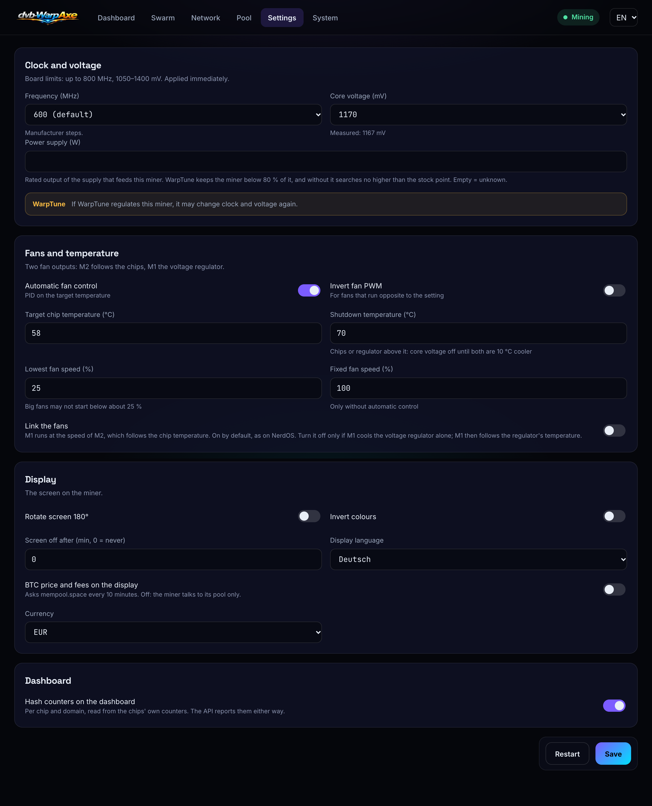
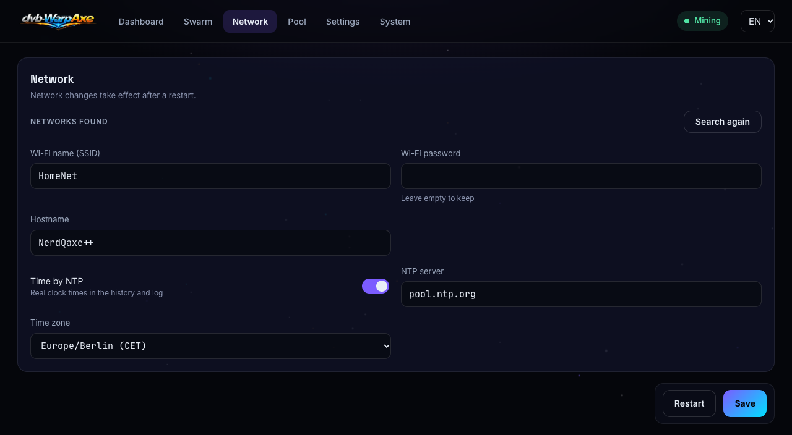
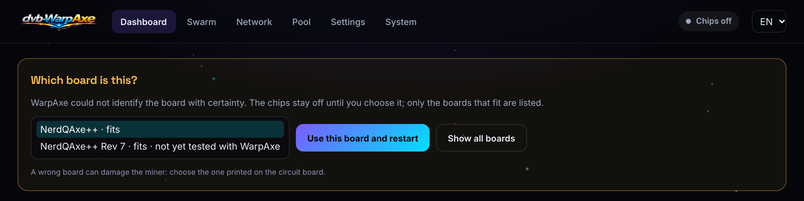
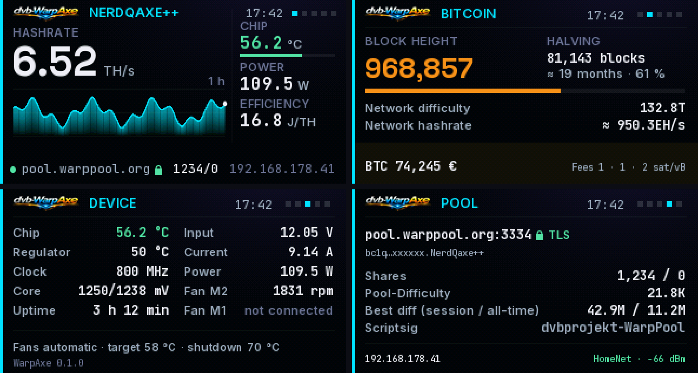
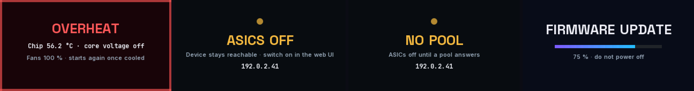
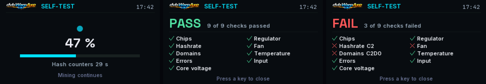

<p align="center">
  
</p>

<p align="center">
  <strong>Open-source Rust firmware for BM1370, BM1373 and BM1397 Bitcoin miners</strong><br>
  Runs on Bitaxe Gamma · NerdQAxe++ · NerdOCTAXE-γ · NerdAxe Gaia · BitForge Nano · NerdNOS<br>
  <a href="#supported-boards">profiles for 7 more boards</a> · experimental on the T-Display-S3 · Stratum V1 + V2 · AxeOS-compatible API · Signed online updates
</p>

<p align="center">
  <a href="LICENSE"></a>
  
  
  
  <a href="https://git.warppool.org/dvb-projekt/dvb-WarpAxe/releases"></a>
</p>

---

dvb-WarpAxe is a from-scratch firmware for ESP32-S3 miners with BM1370,
BM1373 and BM1397 ASICs, written in Rust. It replaces AxeOS (Bitaxe), NerdOS
(the Nerd boards), ForgeOS (BitForge Nano) and the NerdNOS's NerdMiner-based
firmware on the device and speaks their
HTTP API, so dashboards, tuners and fleet tools that talk to a Bitaxe keep
working — including
[WarpTune](https://git.warppool.org/dvb-projekt/dvb-WarpPool), the
clock-and-voltage tuner of dvb-WarpPool.

It does what the stock firmware does — Stratum V2 with the pool's
authority key checked, Stratum V1 over TLS, a fallback pool that hands back
to the main pool — and differs where it counts for running a fleet:
**signed online updates** the miner fetches and checks itself, **one image
for every board** with the board found on the first start and Wi-Fi and
pool taken over from the previous AxeOS, NerdOS or ForgeOS settings, a
**password-protected setup hotspot** when there is no network to join, a
regulator and sensor layer that **rejects implausible readings** instead of
acting on them, the web UI **over the USB cable** as well as over Wi-Fi, and one web
UI in eight languages for the Bitaxe and the Nerd series. The device
display has animated special screens (yes, a found block gets a warp jump),
and the web UI shows a found block in a banner.
See [Compared with the stock firmware](#compared-with-the-stock-firmware)
for where it is ahead and where it is not.

The chip protocol, the chain driver and the board drivers are `no_std`
crates that run under `cargo test` against a simulated chain and a scripted
I²C bus, so most of the firmware is tested on a laptop before it touches a
miner.

> **Status: early (v0.1.40).** It mines 24/7 under WarpTune on five
> boards, one of each: Bitaxe Gamma (since 25 September), NerdQAxe++ (Rev
> 6.1, on Stratum V2), NerdOCTAXE-γ (Rev 3.1, 6-phase regulator, since 28
> September), NerdAxe Gaia and BitForge Nano (since 29 September); since
> 8 October also a NerdNOS (BM1397), its clock set by hand. Seven
> more boards have a profile; of these the Bitaxe Gamma Duo and Gamma
> Turbo have run it at a user's; so has a NerdOCTAXE-γ v2.2 with the
> 4-phase regulator — see [Supported boards](#supported-boards) before you
> flash.

## Compared with the stock firmware

As of 2026-11-04, against [ESP-Miner/AxeOS](https://github.com/bitaxeorg/ESP-Miner)
v2.15.4, [ESP-Miner-NerdQAxePlus](https://github.com/shufps/ESP-Miner-NerdQAxePlus)
(NerdOS) v1.1.1 and [ForgeOS](https://github.com/wantclue/forge-os) v1.7
(the BitForge Nano's firmware, built on ESP-Miner), from their source. All three
move fast; corrections welcome.

| | AxeOS | NerdOS | ForgeOS | WarpAxe |
|---|---|---|---|---|
| Stratum V2 (Noise, authority key, "require authentication") | yes | yes | no | yes |
| Stratum V1 over TLS, certificate checked | yes | yes | yes (on in the factory settings) | yes |
| TLS trust store after the eMudhra incident (October 2026) | curl's pinned extract of 2026-10-20 since v2.15.4 (not yet on the main branch) | curl's pinned extract of 2026-10-20 since v1.1.1 | ESP-IDF's built-in lists, which still carry `emSign ECC Root CA - G3` | curl's pinned extract of 2026-10-20 since v0.1.40, checked in the release build |
| Fallback pool, back to the main pool on its own | yes | yes (plus dual-pool mode) | yes (plus dual-pool mode) | yes |
| Update: miner fetches the release itself | no (download, then upload) | yes (from GitHub) | yes (from GitHub) | yes (from the release page, install on a click) |
| Update image signature-checked before flashing | no | no | no | **yes** (BIP-340, key built into the firmware) |
| An update that does not start falls back to the previous version | no (the bootloader's rollback option is off) | no | no | **yes**, from the bootloader of v0.1.22 on (one reinstall over USB writes it) |
| Images | factory image per board version (update image shared) | one per board | one factory image (one board), plus a firmware and a web-UI image for updates | **one for all boards** |
| Board | set in NVS at the factory | per image | set in NVS at the factory (one board) | **found on the first start** (factory NVS, read-only I²C probe); a board chosen by hand is checked against the bus before any of its pins is driven, and its chips are counted at a cautious voltage before the choice is confirmed ([`docs/11`](docs/11-Board-choice-guard.md)) |
| Settings on an update or reinstall | kept on online update; web flasher can keep them | kept with the update's "keep settings" option | kept on online update; reinstalling the factory image resets them | kept on online update and web-flasher reinstall; **taken over from AxeOS, NerdOS and ForgeOS** when switching (Wi-Fi, pools including AxeOS 2.15's saved list, hostname, clock and voltage, fans and temperature limits, display) |
| Pool changes without a restart | no (the page asks for a restart; instant switching is on ESP-Miner's main branch) | yes | no (the page asks for a restart) | yes |
| Saved pools (more than main + fallback) | yes (up to 8; main and fallback picked from the list, then a restart) | no (main + fallback) | no (main + fallback) | yes (up to 8, each with its coin; one click makes one the main pool, no restart; AxeOS 2.15's list taken over) |
| Who a found block pays (coinbase outputs, your share) | yes (all outputs, your share; Bitcoin addresses only, matched as text, unit BTC) | opt-in (your share and a fee check; Bitcoin addresses only, unit BTC) | yes, partly (up to six outputs and the total; your share not marked; Bitcoin addresses only, unit sats) | yes (all outputs, your share; the address decoded for any SHA-256 coin, CashAddr included, unit the pool's coin; "paid by the pool" for a pool account) |
| A found block | a banner ("Today is your lucky day!") with the count until dismissed, for every browser (the dismiss is stored on the miner); `blockFound` since the start and a `showNewBlock` flag; nothing kept across a restart; "!!! BLOCK FOUND !!!" on the display | nothing in the web UI (an opt-in Discord/webhook alert); `foundBlocks` since the start and `totalFoundBlocks` all time in the API, the total kept in NVS, no height or time; a full-screen image on the display until a key press | nothing in the web UI, the API or on the display | a banner with height, coin and time (gold confetti) until dismissed in that browser, also after a restart; the all-time count in the best-difficulty tile; `blockFound` since the start, `blocksFoundTotal` and `lastBlock` (height, time, coin) in the API, kept in NVS; an entry in the event log; a warp jump on the display |
| Chip error rate on the dashboard | yes (next to the hashrate) | no (per chip in the API since v1.1.1: `errorHashRate` in `/api/v2/dashboard`) | no | yes (next to the hashrate; per chip and domain optional) |
| Chips that stop returning nonces | reported per chip (`hashrateMonitor`), no reaction, also not when all stop | reported per chip; with no share answer from the pool for an hour, a watchdog restarts the miner | not found | all chips silent for a minute: the chain is restarted; **one chip silent for ten minutes** while the others hash: the chain is restarted too (at most once an hour, the chip left alone after three restarts that do not hold; since v0.1.40) |
| One hash domain of a chip stuck while the chip hashes | reported per domain (`hashrateMonitor`), judged in the self-test only | reported per domain, no reaction | not found | **a domain under 25 % of the chip's other domains for ten minutes**: the chips are switched off and on (at most one intervention an hour, shared with the silent-chip restart; the domain left alone after three that do not hold, until a new clock or voltage or the next boot; since v0.1.41) |
| Self-test | yes, instead of mining: after a factory flash (NVS flag) or with the boot key held; a mock job, 30 s hashrate and per-domain counters, core and input voltage, power, fan, temperature; stops at the first failure; PASS/FAIL on the display only | factory flash only (NVS flag), at boot before Wi-Fi: chips found vs expected; input power and core voltage as warnings; hashrate not checked; result on the display only | factory flash only (NVS flag), instead of mining: PSRAM, input, regulator, reference voltages, chips found vs expected, 5 s hashrate (at least 40 % of expected), core voltage, power; result on the two LEDs only | yes, while mining, on a click: nine checks with their figures (chips, hash counters per chip and domain, error rate, core voltage, regulator, fan, temperatures, input) in the web UI, on the display and in the API ([`docs/10`](docs/10-Self-test-diagnostics-and-event-log.md)) |
| Diagnostics file for support | no (log download, up to 512 KB kept on the device) | no (log download of what the open log view received) | no (log download of what the open log view received) | yes: one JSON with state, settings (no passwords, addresses masked), self-test, events and the last log lines; the core dump as a second download (passwords, Wi-Fi name and worker names masked since v0.1.38) |
| Event log across restarts | no (last reset reason; the log survives a soft restart, not a power cycle) | no (last reset reason; optional Discord alert after a no-share reboot) | no | yes: the last 32 events with time (restarts with reason, overheat and regulator stops, pool switches, updates, rollbacks, silent chips, self-tests, board checks, found blocks) in NVS, shown in the web UI's language |
| Notice after a crash | no (reset reason on the System page) | no (reset reason on the System page) | no | yes: a banner after a panic or watchdog, with the reason, the time, the diagnostics file and the core dump if this crash wrote one, until dismissed |
| Overheat stop lines | chip 75 °C, regulator 105 °C, fixed | chip 70 °C (a setting, 50–90), regulator 70 °C on the two-fan boards, none on the one-fan NerdAxe boards | chip 75 °C (either of the two chips), regulator 105 °C, fixed | the stock firmware's lines per board (`docs/08`); the chip line a setting (50 °C up to the board's line; on the NerdOS boards up to 90), the regulator's fixed per board (105 °C on the Bitaxe boards, the BitForge Nano and the one-fan NerdAxe boards, 70 °C on the two-fan Nerd boards as NerdOS); the Nano's chips read on ForgeOS's diode scale since v0.1.36 |
| Back on after an overheat stop | yes (≥ 30 s, regulator 10 °C cooler, then voltage 100 mV and clock 100 MHz lower) | no (board error until reboot) | yes (restarts at once, without a cool-down, at 1000 mV and 50 MHz with the fans at 100 %; clock and voltage set back by hand) | yes (≥ 60 s, chip and regulator 10 °C cooler, at the configured point; the third stop within an hour stays off) |
| Regulator fault (PMBus STATUS_WORD) | reported (`power_fault`), no reaction | read once at init, logged | reported (`power_fault`), no reaction | **reported** (`power_fault` with codes, display and web UI) **and treated like an overheat stop**: core voltage off, faults cleared and retried after a minute, the third within an hour stays off |
| Wi-Fi setup without a network | open hotspot (`Bitaxe_XXXX`), or Bluetooth | open hotspot (`Nerdaxe_XXXX`) | open hotspot (`Nano_XXXX`) for seven minutes after every start, even with Wi-Fi set up; or Bluetooth in the same window | **WPA2 hotspot**, password shown only on the device display |
| Implausible sensor/regulator readings | partly ignored (fan loop) | not found | partly ignored (fan loop and overheat check skip a failed chip-sensor read) | **rejected** before the control loops see them |
| Chip hash counters (per chip, per domain, errors) | yes (`hashrateMonitor`; on the BM1373 four of eight domains, doubled; all eight on ESP-Miner's main branch) | total only | total only (counted per chip and domain, errors too, but not shown) | yes, AxeOS's fields plus a one-minute error rate; **all eight BM1373 domains** |
| Found by name on the network (mDNS `<hostname>.local`, `_http._tcp` with the `_axeos` subtype) | yes | yes | no (DHCP hostname only) | yes (from v0.1.28) |
| Web UI over the USB cable | not found | not found | not found | **yes** (USB network adapter, `192.168.7.1`) |
| Chips off and on again without a restart | yes (pause / resume) | off only; on again needs a restart | no | yes |
| Clock | no NTP; set from the pool's job time | NTP with fixed servers and a fixed time zone (Berlin), no status shown | no NTP; set from the pool's job time | NTP server and time zone in the settings; the web UI shows whether and when the clock was synchronised and how far it is from the browser's |
| Power supply's rating | no (a fixed maximum per board family) | no (a fixed maximum per board) | no (a fixed 60 W) | **set in the settings** (`psuWatts`), so a tuner can keep below it; the dashboard asks for it while it is unknown |
| What the device display shows | fixed pages; settable are the panel type, rotation, inverted colours and screen-off time | fixed pages; settable are flip, inverted colours and screen-off | no display; two status LEDs (the share blink can be switched off) | **choosable**: which LCD pages the key steps through, their order and start page, the cockpit's large number, its three places and its footer line, which OLED slides rotate and for how long; a live view of the screen in the settings |
| Other makers' miners on the swarm page | AxeOS devices only (the browser reads `/api/system/info`) | not found | AxeOS devices only (the browser reads `/api/system/info` and `/api/system/asic`) | AxeOS, NerdOS, ForgeOS, WarpAxe — and an **Avalon over the cgminer API**, found by the network search and read by the miner, read-only |
| Web UI languages | English | 9 | English | 8 |
| Language, tests | C; unit tests (Stratum, ASIC) in CI | C++/C | C; unit tests (Stratum, mining) in QEMU in CI | Rust; chip, chain and board drivers host-tested against a simulated chain and I²C bus |
| Supported boards | ~20 board versions | 11 boards, plus the NerdAxe Gaia since v1.1.1 | 1 (BitForge Nano) | 6 run, 7 more with a profile (see below) |

What the stock firmware offers in addition: AxeOS and NerdOS support far more
boards and have years of use by a large community; AxeOS has a scoreboard, themes,
the BAP accessory port and Wi-Fi setup over Bluetooth; NerdOS has two-factor
login for updates, dual-pool mining, InfluxDB/Grafana export and alerts; ForgeOS
has dual-pool mining, Wi-Fi and pool setup over Bluetooth, and share and
self-test signals on the Nano's two LEDs. WarpAxe is early; if you need any of
that, stay with the stock firmware.

## With WarpTune

[WarpTune](https://git.warppool.org/dvb-projekt/dvb-WarpPool/src/branch/main/scripts/warptune-setup.md#what-each-firmware-gives-warptune),
the clock-and-voltage tuner of dvb-WarpPool, works fully on the stock
firmware — it talks the AxeOS API, and WarpAxe keeps that API. The
difference is what the firmware says about itself: WarpAxe reports these
states explicitly, so WarpTune does not have to guess them from the power
draw:

- **Overheat stop**: `overheat_mode` while it lasts, `overheatTrips` and
  `overheatCause` (hot, a lost sensor, or a regulator fault: `power`, with
  the conditions in `powerFaultCodes`). WarpTune holds during the stop,
  and after a hot stop takes the clock one step down (two from the second
  stop in an hour); a lost sensor is no reason to step down.
- **Chips off or the chain still coming up**: `chainStopped` and
  `chainPhase`, so a chain that is powering up is not taken for a dead chip.
- **Fallback pool** and **reject reasons**, as on current AxeOS.
- **Chip error rate over a minute** (`errorPercentage1m`), from the chips'
  own counters: a voltage that is too low shows in minutes, not after
  hundreds of pool shares.
- **One chip silent** (`silentChips`, `chipSilentRestarts`,
  `lastChipSilentRestart`, `chipsGivenUp`, since v0.1.40): WarpTune (from
  v1.47.0) judges the hashrate on the chips that run instead of
  taking the shortfall for a weak clock, and after the firmware's chain
  restart for that chip settles afresh without a verdict on the step.
- **A stuck hash domain** (`domainLatchResets`, `lastDomainLatchReset`,
  `domainsGivenUp`, since v0.1.41): the firmware switches the chips off
  and on for it; WarpTune waits while the domain is not given up, and
  only then takes its own path (a short voltage lift).
- **Who regulates** (`selfHeals` and `externalRegulator`, since
  v0.1.41): the firmware lists the cases it heals on its own
  (`chain_silent`, `chip_silent`, `domain_latch`), so WarpTune waits on
  those and acts itself on the rest, by the list rather than the
  version number. WarpTune's heartbeat (`POST /api/v1/regulator
  {"ttl_s": 600}`, RAM only: no flash write, no display wake) says it
  is regulating the miner; the firmware's own base regulation, a later
  block, will stand back while `externalRegulator.active` holds.
- **A running self-test** (`selfTest.state`): WarpTune (from v1.42.1)
  holds its writes while one runs, and a clock or voltage change during the test ends it
  rather than spoiling it.

The table on the WarpPool side lists, firmware by firmware, what WarpTune
gets from AxeOS, NerdOS, ForgeOS and WarpAxe.

## Screenshots

### Web UI

<p align="center">
  <br>
  <em>Dashboard — chip grid and series colour, the hashrate with its share of the expected rate, efficiency, power, shares and best difficulty (since start and all-time), the 1 h / 3 h history; below, temperature, fans and power, and the pool with the payout of a found block; at the bottom the hash counters per chip and domain (off by default, switched on in Settings).</em>
</p>

<p align="center">
  <br>
  <em>Swarm — every miner on the network, WarpAxe or stock firmware, read by your browser (an Avalon by this miner, over the Avalon's cgminer API): the fleet's hashrate and each miner's share of it, sparklines, chip and regulator temperatures against their limits.</em>
</p>

<p align="center">
  <br>
  <em>Settings — clock and voltage as the manufacturer's steps, the power supply's rating, fans (on the Nerd boards both linked to the chips by default), display, and the dashboard's hash-counter card (Wi-Fi, hostname and time are on their own Network tab); <code>?oc</code> in the address unlocks free values and the expert section (fan PID, second fan output, suggested difficulty, job interval).</em>
</p>

<p align="center">
  <br>
  <em>Network — Wi-Fi with a list of networks found, hostname, USB address, time by NTP and time zone, and whether and when the clock was last synchronised.</em>
</p>

<p align="center">
  <br>
  <em>System — online update from the releases, upload, download mode for a reinstall with the web flasher, maintenance (switch the chips off while the device stays reachable, reset an overheat stop), the self-test with a ✓ or ✗ per check, the diagnostics file, the event log (in the web UI's language), the way back to the stock firmware and the live log.</em>
</p>

<p align="center">
  <br>
  <em>First start on a board WarpAxe cannot identify with certainty — only the boards that fit what answered on the bus are listed, the rest are behind "Show all boards"; the chips stay off until a board is chosen and, after the restart, has passed the bus check.</em>
</p>

<p align="center">
  <br>
  <em>Pool — the connection (protocol, Noise/TLS, fallback), shares with reject reasons, and who a found block pays: your share, the coinbase value and each output. Below, the saved pools (up to eight, one click makes one the main pool), then main and fallback pool with the coin the pool pays in, each Stratum V1 with optional TLS or Stratum V2 with the pool's authority key.</em>
</p>

### Device display

<p align="center">
  <br>
  <em>NerdQAxe++ (320×170 LCD) — the cockpit and three of the four pages the page key steps through (a log page follows). Block height, halving and network difficulty come from the pool's job; the BTC price line appears only if you switch it on.</em>
</p>

<p align="center">
  <br>
  <em>Block found — stars accelerate into a warp jump, a flash, then the height with shock rings until a key is pressed.</em>
</p>

<p align="center">
  <br>
  <em>Special screens — overheat (pulsing frame), chips off, firmware update with progress.</em>
</p>

<p align="center">
  <br>
  <em>Self-test — the running test, PASS, and a FAIL that names the chip and domain; the OLED shows the verdict and the first failed check (<code>oled-selftest.png</code>).</em>
</p>

<p align="center">
  
  <br>
  <em>Setup hotspot — name and password (new at every start, example shown) on the LCD; on the OLED they take turns with the address.</em>
</p>

<p align="center">
  <br>
  <em>Bitaxe Gamma (128×32 OLED) — hashrate large, rotating values, full-width info slides and the wordmark.</em>
</p>

All display images are rendered from the firmware's own drawing code
(`tools/display-preview`) with sample values; a device's screen can be read
back at any time with `GET /api/v1/display/frame`.

## Features

### Mining
- BM1370, BM1373 and BM1397 chain driver (the BM1397 does not roll the
  version itself: four midstates per job, computed on the ESP32-S3):
  enumeration, baud switch, PLL solved
  (not looked up) and ramped, work dispatch paced per board as its stock
  firmware does, nonce attribution (for 2 s after the ticket mask is raised,
  a nonce below the new mask counts at the old one, so a pool ramping up
  from difficulty 0.001 no longer inflates the hashrate), stale and duplicate
  filtering, per-chip
  silence watchdog. All chips silent for a minute with work going out:
  the chain is started over. Since v0.1.40 also one chip silent for ten
  minutes while the others hash (seen once on a NerdOctaxe after five
  days at a steady clock; until then it stayed dark until the next boot):
  at most one such restart an hour over all chips, and a chip that is
  silent again before it has run an hour after each of three restarts is
  left alone until the next boot or a new clock or voltage. Both clocks
  stop while no work goes out, so a pool outage counts for nothing.
  Since v0.1.41 also one hash domain stuck while its chip hashes (the
  NerdOctaxe's latch, until then seen only after a warm reboot and in
  the self-test): a domain under 25 % of the mean of the chip's other
  domains over ten minutes of fresh counter reads (the window as a
  whole, since the counters are noisy; a weak domain at 50 % is no
  latch, the self-test's limit is 67 %) has the chips switched off and
  on, the way `/api/v1/chips/off` and `/on` do it (chain into reset,
  core off, 500 ms, LDO off on the TPS5364x Nerd carriers — the Gaia's
  stays up —, 5 s down, back on; clock and voltage unchanged): the
  strongest re-init the firmware has short of a new clock or voltage,
  which stays WarpTune's (docs/04 found the warm-reboot latch was an
  init trim and a clock dip brought a dead domain back; a mid-run latch
  has no bench yet). `shutdown` reads true and the phase `OFF` for the
  six seconds or so of the intervention, as for a chips-off by hand;
  the event and `lastDomainLatchReset` say why. The same limits as for
  the silent chip: one intervention an hour over both cases, three
  resets that do not hold and the domain is left alone until a new
  clock or voltage or the next boot. Four domains on a BM1370, eight on
  a BM1373; the BM1397 reports none and is not judged. A BM1370 on a Nerd carrier (NerdQAxe++, NerdOctaxe, NerdQX)
  is brought up with NerdOS's init, a Bitaxe with ESP-Miner's: the two
  differ in one core-clock trim and two writes since ESP-Miner's August
  2026 change, and on a NerdOctaxe at 700 MHz the ESP-Miner init left
  one hash domain of a chip at 3% in four power-ups out of six, NerdOS's
  none in six ([`docs/04`](docs/04-Octaxe-Warm-Reboot-Latch.md)).
- **Stratum V2** per pool: Noise handshake (secp256k1 + EllSwift,
  ChaCha20-Poly1305), extended channel, the pool's certificate checked
  against its authority key (Base58Check, as pools publish it). "Require
  pool authentication" is on by default: without a key, or before the clock
  is set by NTP, there is no connection. Since v0.1.38, in the first five
  minutes after a start, the connect waits up to 20 s for NTP's first sync
  of the boot when NTP is on, and a certificate that fails before it does
  not count towards the fallback (a clock carried across a reset in RTC
  memory can be minutes off after a session in download mode). The TLS switch applies to V1 only;
  V2 is always encrypted. The display shows "V2" with the lock. Settings
  from NerdOS (`sv2_proto`, `sv2_auth_pk`, `sv2_reqauth`) are taken over on
  the first start.
- Stratum V1 with version rolling (BIP 310), `mining.suggest_difficulty`,
  optional **TLS** (esp-tls, hostname checked). Since v0.1.40 every TLS
  connection — the pool, the online update, the price fetch — is checked
  against one pinned CA bundle, curl's extract of the Mozilla store of
  20 October 2026, which no longer has the eMudhra root `emSign ECC Root
  CA - G3` nor `AAA Certificate Services` (ESP-IDF v5.3.3's own lists
  still carry both;
  [`firmware/warpaxe/certificates`](firmware/warpaxe/certificates/README.md)).
  A root of the bundle that the server sends along, cross-signed by an
  older root the bundle no longer has (`api.coingecko.com` sends `GTS Root
  R4` signed by `GlobalSign Root CA`), counts as that root when its name
  and key match; ESP-IDF's verifier alone rejects such a chain
  ([`crates/trust`](crates/trust/src/lib.rs)). A pool whose only chain
  runs to a removed root no longer connects. A pool
  the previous firmware ran on TLS with the owner's own certificate stays
  on TLS here, with the pinned CA bundle, rather than dropping to plain
  text (a pool on a private certificate then fails to connect; TLS can be
  switched off for it). A pool that asks for an extranonce2 size outside 1–16 bytes (V2:
  1–32) is refused instead of trusted.
- **Fallback pool**: after three failed attempts on the main pool; a probe
  every five minutes brings it back as soon as the main pool answers.
- **Saved pools**: up to eight, each with a name and the coin it mines;
  the main pool as it is now is saved with one click, a saved one becomes
  the main pool with another, and the miner reconnects at once. Passwords
  stay on the miner (`GET`/`POST /api/v1/pools`). A first start from AxeOS
  2.15 takes over the pools it had saved.
- The Wi-Fi radio stays awake (no modem sleep), so a new job from the
  pool does not wait for the access point's next beacon (~100 ms). The
  NerdNOS is the exception: fanless next to the ESP32-S3, it keeps modem
  sleep on, as its stock firmware does, to keep the heat down.
- Block height, network difficulty and the pool's coinbase tag read from the
  job; a nonce at or above the network difficulty is reported as a found
  block. Since v0.1.39 the miner keeps the count and the last block
  (height, time, coin) in NVS and records each block in the event log, and
  the web UI shows a banner with confetti until it is dismissed in the
  browser.

### Board
- Regulators: TPS546 (Bitaxe boards, NerdAxe Gamma and Gaia, NerdQAxe++
  Rev 7, BitForge Nano), TPS53647/TPS53667 (NerdQAxe++, NerdOctaxe,
  NerdQX); the core current and the regulator's warning line in the API
  where the regulator reports them. The NerdNOS has none to talk to: its
  rail is fixed by resistors, read on the ADC, and switched with the
  chip's run/stop line.
- Never a core voltage below the regulator's clean range: the TPS546
  driver refuses anything under 0.25 V ÷ VOUT_SCALE_LOOP (TI's reference
  range), the API refuses it with 400 and publishes the floor as
  `regulatorMinMv`, and a request the regulator turned down is shown as
  `coreVoltageRefused` instead of counting as applied. The NerdAxe Gaia
  runs on the 0.5 divider (clean 0.5–1.5 V) so its 800–970 mV lie inside
  it — the divider the board's own straps set at power-up; the stock
  firmware's 0.25 put them below. `vrProbe` shows what the regulator held
  at boot, before the firmware wrote it.
- Sensors and fans: EMC2101, EMC2103, EMC2302 (two outputs), TMP1075,
  INA260 (BitForge Nano), FXL6408 GPIO expander, an NTC thermistor on the
  ADC (NerdNOS).
- Fan PID with ESP-Miner's gains; a second output linked to the chip fan
  by default, as on NerdOS (*Link the fans* off: it follows the regulator
  temperature instead, for a fan that cools only the regulator); minimum
  speed, polarity. After the core voltage comes on — at start and after an
  overheat stop — the fans stay at full until the chips are near their
  target, then the PID takes over from there instead of running them down
  on a cold board. Boards with one fan for chip and regulator (NerdAxe) run it for
  whichever of the two needs more (regulator target 80 °C).
- Overheat shutdown of the core voltage at the stock firmware's lines
  (Bitaxe: chip 75 °C, regulator 105 °C as AxeOS stops; BitForge Nano the
  same, as ForgeOS stops, on ForgeOS's diode scale since v0.1.36;
  NerdQAxe/NerdOctaxe/Q13xx: 70 / 70 as NerdOS; NerdAxe Gamma 70 / 105 and
  NerdAxe Gaia 75 / 105 — NerdOS has no regulator stop on these one-fan
  boards, WarpAxe keeps AxeOS's 105 on the same TPS546; NerdNOS: 80;
  [`docs/08`](docs/08-Temperature-stop-limits-against-the-stock-firmware.md)).
  The chip line is a setting: on the NerdOS boards up to 90 °C as NerdOS
  allows, on every other board only below its own line; the regulator's is
  fixed per board. There is also a guard for a lost chip sensor
  (60 s blind = off, once the chip temperature has been read; a board whose
  chip sensor never answers runs like NerdOS, on the regulator limit with
  the fans at full, and says so in the log). The chips start again on their own once chip and
  regulator are 10 °C below their limits (at least 60 s off; after a lost
  sensor only with real readings back); the third stop within an hour stays
  off until it is cleared by hand.
- **Board-choice guard**: a board is checked against the I²C bus before
  any of its pins is driven, by the parts its profile needs and the ones
  it must not see (the regulator's input voltage tells the NerdAxe Gaia
  from the NerdAxe Gamma); its first start runs at a cautious voltage and
  counts the chips, and a wrong count or chip type switches the rail off
  again. A missing sensor on a new choice is refused as well. `PATCH
  /api/system {"boardModel": "<name>", "reverify": true}` puts a verified
  board through the check again
  ([`docs/11`](docs/11-Board-choice-guard.md)).
- Plausibility windows for every reading: a
  regulator that answers garbage while it powers up is reported as "no
  reading", never as a value a tuner could act on.
- Switch the chips off and on again from the web UI or the API; the device
  stays reachable. On the Nerd carriers with an LDO for the chips' I/O
  rails (NerdQAxe++ Rev 6, NerdOctaxe, NerdQX) "off" — by hand, by an
  overheat stop, or before a restart — is the stock firmware's
  shutdown: chain in reset, core rail off, half a second, LDO off, and
  the chain's TX line parked low meanwhile; "on" is its bring-up
  order. A reboot that was not a power-on keeps the rails off for five
  seconds before the LDO comes back, the pause a power cycle gives them
  ([`docs/04-Octaxe-Warm-Reboot-Latch.md`](docs/04-Octaxe-Warm-Reboot-Latch.md)).

### Web UI and API
- One UI for every board, series colour and chip grid on the type plate;
  English, German, Spanish, French, Italian, Brazilian Portuguese,
  Japanese and Chinese, each translated and then proofread on its own as a
  whole (the device display in the six Latin-script ones).
- Dashboard and Pool page in the warp design: one hero with the hashrate,
  its share of the expected rate and the 1 h / 3 h history (hashrate as a
  two-minute average, temperature in steps of at least 0.5 °C, so counting
  noise does not fill the chart), then temperature, fan/power and pool
  instruments — input voltage, core voltage and core current on rows of
  their own, the input current only where the board measures it (on the
  NerdAxe an estimate, marked ≈), so a Bitaxe's 40 A of core current does
  not read as drawn from the power supply; a notice asks for the power
  supply's rating (*Settings*, in watts) until it is set or dismissed; the best difficulty since the start next to the all-time
  best, which survives restarts, and, once the miner has found a block, the
  number of blocks found; the chips' error rate over the last minute
  next to the expected hashrate, as AxeOS shows it; live log. Optional
  (*Settings → Dashboard*, off by default): the hash counters per chip and
  domain, a weak domain marked in colour, and a total line on boards with
  several chips. The BM1373 has eight hash
  domains, not four: WarpAxe reads all eight counters (0x88–0x8B and
  0xAC–0xAF), where AxeOS reads four and doubles them. Its error rate runs
  higher than the BM1370's (about 2.5% on a NerdAxe Gaia at its hand
  point, rising steeply at low core voltage) and is shown without a colour.
- **Coinbase payout** of every job, as AxeOS shows it: the share of a found
  block that goes to your address (green from 95%, red below), the
  coinbase value and its outputs, over Stratum V1 and V2. The address in
  the worker name is decoded (base58, bech32/bech32m, CashAddr) and matched
  against the output scripts, so the split is right when solo mining
  another SHA-256 coin too (BCH, eCash, DigiByte, FixedCoin…); the
  outputs are written the way that coin writes addresses, and the amounts
  carry the coin set for the pool (*Coin*, default BTC). A worker name that
  is a pool account, not an address, shows "paid by the pool".
- **Swarm** page for the other miners on the network — AxeOS, NerdOS,
  ForgeOS or WarpAxe: fleet hashrate, power, J/TH and record difficulty,
  each miner's share, a card per miner with a sparkline and its
  temperatures. The browser reads every miner's `/api/system/info` directly
  (every 30 s by default, not while the tab is hidden, one request per
  miner at a time); this miner stores only the address list. Read-only: it
  never changes or restarts another miner. Add miners by address or by a
  search of the local /24. An **Avalon** (cgminer API on TCP 4028, which
  a browser cannot open) is found by that search as well: the miner walks
  its own /24 for port 4028, six connections at a time with a hard 30 s
  budget, asks a host that answers for its `version` and nothing else,
  and the hit shows as "Avalon · cgminer" beside the others; adding it
  (or typing it as "Avalon (cgminer API)") stores `cgminer:<ip>`. For
  the card the miner reads its `summary`, `estats` and `pools` — those
  reads and nothing else, one at a time, cached for 10 s, only for hosts
  on the list — and shows its work mode (Eco / Standard / Super), chip
  temperatures, fans, power, shares and best share
  (`GET /api/v1/swarm/cgminer?host=`, `POST`/`GET /api/v1/swarm/cgminer/scan`;
  [`docs/07`](docs/07-Display-choices-and-Avalon-swarm.md)).
- Found by name: the miner announces itself over mDNS as
  `<hostname>.local` (letters, digits and `-` of the hostname; a name
  already taken gets `-2`) and as `_http._tcp` with AxeOS's `_axeos`
  subtype and TXT items (board, family, asic, asic_count, fw_version), so
  tools that discover Bitaxes that way find it; the router's DHCP sees
  the same name.
- Tabs in the stock order: Dashboard, Swarm, Network, Pool, Settings,
  System; the starfield background of dvb-WarpPool. The browser tab names
  the miner ("NerdAxe Gaia · WarpAxe"), so several open tabs tell their
  miners apart.
- AxeOS/NerdOS-compatible endpoints: `/api/system/info`, `PATCH
  /api/system`, `/api/system/asic`, `/api/v2/settings`, NerdOS's
  `/api/v2/dashboard` (its `performance` object: hash rates and, per chip,
  the hash rate and the error hash rate), restart, OTA upload.
- WarpAxe's own: `/api/v1/state`, `/api/v1/history`, `/api/v1/log`, chips
  off/on, a tuner's heartbeat (`POST /api/v1/regulator {"ttl_s": 600}`;
  60–3600 s, 600 without a value, 0 ends it; RAM only, reported as
  `externalRegulator {active, expires_in_s}`), overheat and best-difficulty reset, the self-test (`POST`/`GET`/
  `DELETE /api/v1/selftest`), the diagnostics file (`GET
  /api/v1/diagnostics`), the event log (`GET /api/v1/events`), Wi-Fi scan, display frame /
  key / demo, online update, download mode for the web flasher, the swarm
  list (`/api/v1/swarm`), an Avalon read for it
  (`/api/v1/swarm/cgminer?host=`) and the search for one
  (`/api/v1/swarm/cgminer/scan`), the last crash's core dump
  (`GET /api/v1/coredump`, an ELF for `espcoredump.py`, secrets masked;
  `DELETE` erases it),
  and for diagnosis a read-only chip register scan
  (`/api/v1/chip/regs?chip=0&from=0x80&to=0xbf`) and the nonces per core
  (`/api/v1/chip/cores`).
- States a tuner would otherwise have to guess from the power draw are in
  `/api/system/info`: `chainStopped` and `chainPhase`, `overheat_mode`,
  `overheatTrips` (stops in the last hour), `overheatCause` (hot, a lost
  sensor or a regulator fault), `overheatLatched`, `power_fault` (AxeOS's
  field and wording) with `powerFaultCodes`, `isUsingFallbackStratum` (also as NerdOS's
  `stratum.usingFallback`),
  `sharesRejectedReasons`, AxeOS's `coinbaseOutputs`,
  `coinbaseValueTotalSatoshis` and `coinbaseValueUserSatoshis` with
  `coinbaseOwnAddress` (the worker name is an address) and
  `coinbaseBitcoin` (it is a Bitcoin one) and the pool's `coinTicker`,
  `overheat_temp` (the chip stop in force) with `overheatTempMax` and
  `vrOverheatTemp`,
  `temptarget` (the fan target, under ESP-Miner's name) so a tuner keeps
  its own target above it, `coreCurrentA` with `coreCurrentWarnA`,
  `faultCause` (why the regulator stopped), `regulatorMinMv` and
  `coreVoltageRefused` (the regulator's floor and a request it refused),
  `vrProbe` (the regulator's window as found at boot),
  `silentChips`, `chainSilentRestarts` and `chainSilentRestartsSameMv`
  (chips without nonces, and chain restarts after a silent minute — in
  all, and in a row at the current core voltage: two or more mean the
  chips do not run at it), `chipSilentRestarts`, `lastChipSilentRestart`
  (`chip` from 0, `mv`, `uptime_s`; null until the first) and
  `chipsGivenUp` (chain restarts for one silent chip since v0.1.40, the
  last one, and the chips left alone after three that did not hold;
  `chainSilentRestarts` keeps counting only the all-chips case),
  `domainLatchResets`, `lastDomainLatchReset` (`chip` and `domain` from
  0, `percent` the domain's share of the mean of the chip's other
  domains over the ten minutes, `uptime_s`; null until the first) and
  `domainsGivenUp` (`[{chip, domain}]`; chips off and on for a stuck
  hash domain since v0.1.41), `selfHeals` (the cases this firmware heals
  on its own: `["chain_silent", "chip_silent", "domain_latch"]`) and
  `externalRegulator` (`{active, expires_in_s}`, a tuner's heartbeat;
  `{false, 0}` without one, also after every boot),
  `gitHash` (the commit the
  image was built from), `blockFound` (blocks found since the start),
  `blocksFoundTotal` (all time) and `lastBlock` (`height`, `time` as Unix
  time or 0 without a clock, `coin`; null until the first block), both
  kept across restarts, and AxeOS's `hashrateMonitor` (per chip the
  hashrate from the chip's own counters, its domains — four, eight on the
  BM1373 — and the error counter, read once a second) with
  `errorPercentage` (AxeOS's per-second
  value) and `errorPercentage1m` (over the last full minute, for tuners).
  Also `resetReason` with `resetCause` (the raw RTC reset cause, since
  v0.1.38), `otaState` (the running image: `valid`, `pending-verify`, or
  `aborted` after a rollback), `dieTempC` (the ESP32-S3's own sensor),
  `yieldPercent` (the nonce-weighted 10-minute rate against small cores ×
  clock, on chips without an error counter such as the BM1397),
  `clockStep` (a step down after an overheat on a board without a fan to
  drive), `hasFan`, `hasVr` and `powerEstimated` (what the board has
  to measure and drive), and `ntpLastSync` (when SNTP last set the
  clock; the Network tab shows it, and how far the miner's clock is from
  the browser's, since TLS and an authenticated Stratum V2 pool wait for
  the time), and `psuWatts` (the rated output of the miner's power supply,
  entered once in Settings, so WarpTune knows its 80% limit without its
  own configuration; several miners on one supply each get their share of
  its rating; null while unknown), `boardDetect` (on a board's first
  start: the board found or chosen, where its check stands, the cautious
  voltage, and why a board was refused), and `mdnsHostname` / `fullHostname`
  (the name the miner announces over mDNS, as AxeOS reports it).
- **Setup hotspot**: with no network in the settings, or none reached within
  three minutes of a start, the miner opens `WarpAxe-XXXX` — WPA2, with a
  ten-digit password generated at every start and shown only on the device
  display. A phone that joins it gets the Wi-Fi setup page by itself
  (captive portal); after saving, the miner restarts, joins the network and
  closes the hotspot. The log names the address behind every restart,
  download-mode and overheat-reset request.

### Device display
- 320×170 LCD (Nerd boards, Bitaxe Naja Duo and Gamma Hex): cockpit with
  the last hour's hashrate, Bitcoin, device, pool and log pages,
  anti-aliased fonts (Space Grotesk, JetBrains Mono, Inter) pre-rendered at
  build time.
  On a board without regulator or fan (NerdNOS) the device page shows
  what it has instead: the ESP32-S3's temperature, the effective rate, the
  Wi-Fi signal, the clock after a restart and the shutdown temperature.
- Bitaxe OLED: large hashrate, rotating values, info slides, share blink.
- Boot screen: the WarpAxe logo, and on the colour-display boards the
  maker's wordmark under it (NerdQAxe++, NerdOctaxe, NerdAxe Gamma, NerdQX,
  NerdAxe Gaia, NerdNOS, Bitaxe Naja Duo and Gamma Hex), shown with the makers'
  consent; the small-OLED Bitaxes show the model name instead.
- Special screens for block found, overheat, chips off and firmware update;
  display language, time zone, screen timeout.
- **What the display shows is yours to choose** (Settings → Display, with
  a live view of the screen): which LCD pages the key steps through, in
  what order and which is the start page; the cockpit's large number
  (hashrate, efficiency or power — the curve under it follows), its
  three places (chip or regulator temperature, power, J/TH, fan, shares,
  best difficulty, block height, BTC price, pool difficulty, uptime,
  input voltage) and its footer line; on the OLED which slides rotate
  and for how long. The factory layout is the one above; a value a
  board does not have shows as a dash. API: `displayPages`,
  `displayStartPage`, `cockpitBig`, `cockpitSlots`, `cockpitFooter`,
  `oledSlides`, `oledInterval`, `displayKind`
  ([`docs/07`](docs/07-Display-choices-and-Avalon-swarm.md)).
- Optional BTC price and fee rates from mempool.space — **off by default**;
  with it off the miner talks to its pool and nothing else (plus the update
  check, which you can switch off too).

### Self-test, diagnostics and event log
- **Self-test** on a click under System, while the miner mines, about
  80 s: chip count, every chip's and every domain's hash counter over a
  60-second window, the error rate against a line per chip type (5% on
  the BM1370, 8% on the BM1373), the core voltage against the set value,
  the regulator's status, the fans' speed at 100% for 10 s (the step
  never lowers what the fan control wants, and the board task drops it
  by itself when the time is up), chip and regulator temperatures under
  their stop lines, the input voltage. One PASS/FAIL with every check's figure in the web UI,
  on the display and in the API; a clock or voltage change during the
  test ends it. It also runs once by itself after a board's verified first start.
  The limits and where they come from:
  [`docs/10`](docs/10-Self-test-diagnostics-and-event-log.md).
- **Diagnostics file** (`GET /api/v1/diagnostics`): one JSON with the
  firmware, board, self-test result, hash counters, pool status,
  regulator and temperatures, memory, event log, settings and the last
  log lines. No passwords; the worker's address and the Wi-Fi name are
  masked, and every section is scrubbed of every secret the firmware
  knows before it is written.
- **Event log** across restarts: the last 32 events (restart with its
  reason, overheat stop with its cause, regulator fault, pool switch,
  update or rollback, silent chip and a chain restart for it, self-test
  result, board check, found block) with
  time and uptime, under System, in `/api/v1/state`, `/api/v1/events` and
  in the file. The web UI shows each event's details in its own language;
  the API and the file keep the English text in `d`, with a short code
  and the values beside it (`c`, `p`). Written on
  events only, never on a timer, from threads with an internal stack.
- **After a crash** (panic or watchdog) the web UI shows a banner until
  it is dismissed: the reason and the time, a button for the diagnostics
  file and, if this crash wrote one, one for its core dump. A dump only
  counts as this crash's when the running image wrote it and no earlier
  boot reported it; otherwise the banner says no dump was written, and
  the Diagnostics card marks a dump left in flash as an older one. Since
  v0.1.37 a Rust panic also leaves its last words (task, file and line,
  message) in memory that survives the reset, and a stack overflow the
  name of its task; the next boot logs them and the diagnostics file
  carries them as `lastWords`, with or without a dump. Other crashes (a
  hardware exception, a watchdog) leave no last words, only the core
  dump. A crash during a restart (after an update, an upload, a restart
  from the web UI or on the way into download mode) becomes an event of
  its own that names the step, and a finished update or upload reports
  itself as installed on every bootloader, but not after a rollback; both
  need the restart to be begun by v0.1.37 or later. Up to v0.1.37 the way
  into download mode itself crashed every time (TinyUSB was shut down
  while the console still wrote to its serial port, an assert); since
  v0.1.38 the console goes back to USB-Serial/JTAG first. After the way
  into download mode a panic, or a task or interrupt watchdog the panic
  handler went through, is a crash of that restart; a watchdog reset
  without the panic handler is the flashing tool's way out of download
  mode (esptool's hard reset can arrive as a task watchdog) and is not.
  The boot line, `/api/system/info` and the diagnostics file carry the raw
  RTC reset cause as `resetCause`. The core dump
  partition is 256 KB since v0.1.37 (64 KB before, too small for most of
  this firmware's dumps); it arrives with one install from the browser
  (or over USB), not with an online update
  ([`docs/12`](docs/12-Panic-without-a-core-dump-in-the-restart-after-an-update.md)).
- **Core dump download** (`GET /api/v1/coredump`): since v0.1.38 the
  Wi-Fi password, the pool passwords, the hotspot password, the Wi-Fi name
  and the worker names and addresses are replaced with as many `x`, and
  the CRC32 is recomputed, so `espcoredump.py` still reads the file; the
  copy in flash stays as written.

### Updates
- **Online update**: the miner checks this repository's releases at start
  and every hour, the web UI shows the new version and its notes (and a
  pill in the header on every page), and
  one click downloads, verifies (SHA-256 and the release signature: BIP-340
  Schnorr with the key built into the firmware, `warpaxe.bin.sig`) and
  installs it. A release without a signature still installs for now and is
  marked as unsigned; that tolerance ends once every release carries one.
  Nothing installs by itself: an update restarts the miner. While an
  install is queued, downloading, verifying or flashing, a second one is
  refused (409), and the web UI disables the button on the click (since
  v0.1.38; before, a second click could start the install again after a
  failed first attempt).
- **The writer needs no free memory**: the online update, an upload, a
  restart and download mode are carried out by the firmware's main task,
  whose stack exists from boot on, so an update works however fragmented
  the internal heap is after days of mining (up to v0.1.31 an update
  could be refused with 45 KB free but no contiguous 16 KB block). A second image
  while one is queued or being written is refused at once (409 on the
  upload); `largestFreeInternal` in `/api/system/info` shows the largest
  free block ([`docs/09`](docs/09-Update-with-a-fragmented-heap.md)).
  From v0.1.33 the write runs at the priority the old writer thread had,
  so it no longer waits behind the mining and network threads: on a
  NerdQAxe++ an update takes about 60 s from upload to restart instead of
  144 s.
- **Chips off before every restart**: an update, a restart and download
  mode first switch the core voltage off and hold the chips in reset, and
  every boot does so before anything else. A TPS546 keeps its output on
  through an ESP reset, so the chips would otherwise sit powered and
  unwatched — a BitForge Nano reached 82 °C (on the diode scale of the
  time; regulator 95 °C) after three minutes in download mode. On boards
  with native USB a `B` on the USB console port (the serial port beside
  the USB network adapter) takes the same way as *System → Download
  mode* since v0.1.38 — before, it rebooted into the ROM with the chips
  still powered and no restart marker; if the firmware does not take the
  request within 10 s, it reboots into download mode directly.
- **Back to the stock firmware**: *System → Back to the stock firmware*
  explains the way (over USB, with the backup the web flasher saved) and
  opens the flasher's restore section.
- **Rollback** of an update that does not start: the new image boots on
  trial and marks itself good once the chips run (at the latest after
  three minutes up); a reset before that — a crash, the watchdog, a power
  cut — brings the previous version back, and the System page says so
  (`otaState` `aborted`). This needs the bootloader of v0.1.22 or later,
  which only a USB install writes: a reinstall with the web flasher
  (settings kept) gives it to a miner that has only ever been updated online.
- Downloads are tried up to three times; the log names the address that
  started an install, an upload or an update check, and the last install
  (version and signature result) is kept across the restart. Every
  settings change is logged with the address it came from (`/api/v1/state`
  → `config_patches`). A web UI tab open during an update from elsewhere
  reloads itself once the miner answers with the new firmware.
- Pool settings apply at once: a change to the main or fallback pool, the
  worker or the suggested difficulty closes the session and the miner
  reconnects with the new settings, no restart.
- Upload a `warpaxe.bin` in the web UI, or `curl --data-binary @warpaxe.bin
  http://<miner>/api/system/OTA` — a manual upload is your own image and is
  not signature-checked.
- The web UI and its fonts are part of the image: one file, one update.

## Supported boards

| Board | ASICs | Regulator | Status |
|---|---|---|---|
| Bitaxe Gamma (601/602) | 1× BM1370 | TPS546 | **runs 24/7** |
| NerdQAxe++ (every revision but Rev 7; NerdOS treats them alike) | 4× BM1370 | TPS53647 | **runs 24/7** (on a Rev 6.1) |
| NerdQAxe++ Rev 7 | 4× BM1370 | TPS546 (two voltage domains) | profile from NerdOS, recognised on the bus and offered for one click; not run yet |
| NerdOCTAXE-γ Rev 3.1 | 8× BM1370 | TPS53667 (6-phase) | **runs** since 2026-09-28; at 700 MHz / 1210 mV the pool counts 11.59 TH/s ±2.5% (NerdOS: 11.71) since v0.1.9 paces work as NerdOS does; a v2.2 board with the 4-phase TPS53647 runs at a user's since 2026-10-01 (it overheated until its second fan was linked to the chip fan, now the default) |
| BitForge Nano (800) | 2× BM1370 | TPS546 + INA260 | **runs** since 2026-09-29 (ForgeOS's Medium preset 525 MHz / 1150 mV: 2.19 TH/s at 43–45 W; 625 MHz / 1160 mV, just below ForgeOS's Power preset: 2.53 TH/s at 37–38 A); taken on the first start since v0.1.35 (its PCA9544 mux and INA260 exist on no other board); since v0.1.36 its regulator limits (38 / 40 A, 13.5 V input) and chip diode scale are ForgeOS's ([`docs/08`](docs/08-Temperature-stop-limits-against-the-stock-firmware.md)) |
| Bitaxe Gamma Duo (650) | 2× BM1370 | TPS546 | profile; runs at a user's since 2026-09-30 (v0.1.10), not on our bench; free clock values with `?oc` as on the Gamma |
| Bitaxe Gamma Turbo (801) | 2× BM1370 | 2× TPS546 | profile; runs at a user's since 2026-10-01 (v0.1.11), not on our bench (a pair at 850 MHz / 1250 mV under AXP90 coolers); free clock values with `?oc` as on the Gamma |
| Bitaxe Naja Duo (1201) | 2× BM1373 | 2× TPS546 (two domains) | profile only, not run yet; free values up to 600 MHz, the maker's documented overclock (600 MHz / 1120 mV, untested by us) |
| Bitaxe Gamma Hex (1300) | 6× BM1370 | 4× TPS546 (two domains) | profile only, not run yet |
| NerdAxe Gamma | 1× BM1370 | TPS546 | profile only, not run yet |
| NerdAxe Gaia | 1× BM1373 | TPS546 (12 V) | **runs** since 2026-09-29; at 420 MHz / 960 mV the pool counts 102% of the expected rate, as with its stock firmware, but the core then draws 31–33 A against the regulator's 33 A limit, so ours runs at 380 MHz / 960 mV (31 A); clock and voltage capped at 420 MHz / 970 mV; since v0.1.16 its regulator runs in the range the board is strapped for (0.5–1.5 V); taken on the first start since v0.1.35 (TPS546 and EMC2101 on the Nerd pins with 12 V at the regulator; the same parts at 5 V are a NerdAxe Gamma) |
| NerdQX (Q1370 / Q1373) | 4× BM1370 / BM1373 | TPS53647 or, on the Q1373, the 6-phase TPS53667 | profile only, not run yet |
| NerdNOS (T-Display-S3 carrier, rev 1.3) | 1× BM1397 | TPS566247, fixed by resistors (about 1.4 V), enabled by the firmware | **runs** since 2026-10-08: at 300 MHz the pool counted ≈190 GH/s over an hour, the stock firmware ≈180 GH/s on the same pool and clock (±6–9% each); ours runs there, at about 73 °C with a case fan (the board has none of its own); after an overheat stop it comes back one clock step lower; the clock is set by hand, the temperature comes from a thermistor, the power is an estimate; taken on the first start when the thermistor on GPIO2 and the 1.4 V rail on GPIO3 both answer (the buck switched on for 150 ms for the reading, the chip held in reset); the chip runs only from the carrier's own USB-C. Details: [`docs/03`](docs/03-NerdNOS-BM1397-against-the-references.md) |
| LilyGO T-Display-S3 (NerdMiner hardware) | none: the ESP32-S3's SHA unit and one CPU core | none (USB power) | **experimental**, see below |

Boards marked "profile only" have pins, regulator window and limits taken
from their stock firmware, but nobody has run WarpAxe on one yet. Please
don't flash them unless you can recover the stock firmware over USB.

### Experimental: the T-Display-S3 without an ASIC

> ⚠️ **Hot to the touch.** Hashing all the time, the T-Display-S3 gets to
> about 60 °C on its back. Put it in a case before you leave it running,
> and don't hold it in your hand while it mines.

The LilyGO T-Display-S3, the board NerdMiner runs on, has no mining chip.
WarpAxe hashes on the ESP32-S3 itself there: the chip's SHA unit on one
core with a precomputed midstate, as NerdMiner v2 does (`src/mining.cpp`),
and a software loop on the other, together about 340 kH/s on USB power
(`docs/06-Devkit-S3-SHA-Peripheral.md` has the measurements).
That is a lottery ticket, not a miner: at today's network difficulty the
expected time to a block is far longer than the age of the universe.
It is marked experimental. It takes online updates like every other
board, but only releases that ran on a T-Display-S3 before they were
published: a release lists the boards it was tested on in
`tested-on.txt`, and the T-Display-S3 shows a newer one without it as
"not yet released for this board" and does not install it.

- Installed with the same image and the same web flasher as every other
  board. On the first start a board on which nothing answers on the I²C
  bus and that still holds a NerdMiner's settings becomes the
  T-Display-S3: Wi-Fi from the ESP's Wi-Fi storage and the wallet from
  NerdMiner's `config.json` are taken over, the worker is
  `<wallet>.WarpMiner`, the pool is WarpPool (Stratum V1, a share
  difficulty of 0.005, about 40 shares an hour). Without NerdMiner's
  settings it is offered in the board choice, never taken on its own.
- Stratum V2 works too: WarpPool from v1.37.1 recognises the board by its
  agent string (`warpaxe-cpu/… (nerdminer-class)`) and opens its channel
  at the same small difficulty. Other Sv2 pools may start a channel far
  too high for a few hundred kH/s, so that no share ever arrives; stay on
  V1 there.
- The web UI and the display show kH/s, the ESP32-S3's own temperature,
  shares per hour and the uptime; its Settings page has the display only
  (no clock, voltage or fans). At 85 °C the
  hashing pauses, at 75 °C it resumes.
- The way back to NerdMiner is the web flasher's full backup, restored
  over USB (download mode: hold BOOT, press RST, release BOOT).

## Install

New to WarpAxe? The **[user manual](https://docs.warppool.org/warpaxe-guide.html)**
(PDF, in English, German, French and Spanish) walks through the install, the
first start, every page of the web UI, the display, updates and the way back,
step by step.

**First install** needs a USB cable once; after that the miner sets itself
up and updates itself:

1. **Keep a way back** — the web flasher saves the miner's whole flash
   (16 MB: stock firmware and settings) into a file you choose before it
   writes anything (on by default, about 2½ minutes, every block checked
   against the chip), and its *Restore a backup* section puts such a file
   back. Without the browser, `tools/flash-backup.sh` does the same with
   esptool. Or keep the stock firmware at hand (the
   [Bitaxe](https://bitaxeorg.github.io/bitaxe-web-flasher/) and
   [NerdQAxe](https://shufps.github.io/nerdqaxe-web-flasher/) web flashers
   put it back; for the other boards, the maker's own flasher or image).
2. Install WarpAxe from the browser with the **web flasher at
   [warppool.org/warpaxe](https://warppool.org/warpaxe/)** (Chrome or Edge
   on a computer). It writes bootloader, partition table and app and
   leaves the settings partition alone, so WarpAxe reads what AxeOS or
   NerdOS left there; it checks every part against the flash and restarts
   the miner when it is done. (A miner first installed with WarpAxe
   before v0.1.37 and since updated only online keeps its old partition
   table, whose core dump partition of 64 KB is too small for most of this
   firmware's crash dumps; one flash from the browser gives it the 256 KB
   table and keeps the settings, docs/12.) The flasher serves the current
   release; its
   image carries the same signature the online update checks. Coming from
   the stock firmware, the flasher usually puts the miner into download
   mode by itself; otherwise hold BOOT, press RST, release BOOT (on a miner
   that already runs WarpAxe: *System → Download mode*, or a `B` on its
   USB console port). A miner that
   stays dark after a cancelled install is still in download mode: take it
   off power completely — power supply **and** USB cable — for a few
   seconds. Without a browser: `warpaxe-factory.bin` from the
   release at offset 0 with esptool (this one starts with empty settings),
   or [Build from source](#build-from-source).
3. On the first start WarpAxe takes **Wi-Fi, pools, hostname, clock and
   voltage, fan settings, temperature limits and display orientation** from
   the previous firmware (not the fan PID gains, which belong to its own
   loop; and not clock, voltage and fans if that firmware was in its
   overheat mode, whose emergency point no owner chose) and finds the
   **board**: from the model AxeOS stored at
   the factory, or from the chips that answer on the board's I²C bus
   (read-only probes on pins that switch nothing). A board found for sure
   (a Bitaxe Gamma, a BitForge Nano, a NerdAxe Gaia) starts at once.
   Otherwise — the NerdQAxe++ and the NerdOctaxe look alike on the
   bus, and a board that has never run WarpAxe is only offered — the web
   UI asks once which board it is, listing only the boards that fit, and
   the chips stay off until you answer. A core rail the stock firmware
   left on is switched off meanwhile; the display already runs, so the
   setup hotspot's name and password show while you choose. Every board,
   found or chosen, is checked against the bus before any of its pins is
   driven; its chips then come up at a cautious voltage (the lowest of
   the boards that look alike on the bus) and are counted. When their
   number and type match the profile, the board counts as verified, the
   configured voltage applies and the self-test runs once by itself; a
   board that does not fit is refused with the reason, and the chips stay
   off. A board set up by an earlier WarpAxe version is taken as verified
   on the update ([`docs/11`](docs/11-Board-choice-guard.md)).
4. Open the web UI at the miner's address — or, on boards with native USB,
   at `http://192.168.7.1` over the USB cable (the miner shows up as a USB
   network adapter; a second WarpAxe on the same computer needs another
   number in *Network → USB address*, e.g. 192.168.8.1). If there was no Wi-Fi to take over, or it cannot be
   reached, the miner opens its setup hotspot after three minutes: join
   `WarpAxe-XXXX` with the password on its display and choose your network.

**Updates** after that come from the web UI: *System → Online update →
Install* (a bar under the header follows it on every page and says when
the miner is back on the new version), or upload `warpaxe.bin` from the
[releases page](https://git.warppool.org/dvb-projekt/dvb-WarpAxe/releases).
Every release carries `warpaxe.bin` (one image for all boards — the board is
configuration), `warpaxe.bin.sha256`, `warpaxe.bin.sig` and `tested-on.txt`
(the boards it ran on before it was published); for the first
install also `warpaxe-factory.bin` (bootloader, partition table and app in
one image) and `web-flasher.tar.gz` (the web flasher as published), with
their checksums in `install.sha256`. `tools/verify-release.py` checks an
image's signature without the Rust toolchain.

## Build from source

Host crates and tests:

```bash
cargo test --workspace
cargo clippy --workspace --all-targets -- -D warnings
cargo build -p warpaxe-core -p warpaxe-chain -p warpaxe-board -p warpaxe-ota \
    --target thumbv7em-none-eabihf                             # proves no_std
```

Firmware (Xtensa, ESP-IDF 5.3 via `esp-idf-svc`; toolchain from
[espup](https://github.com/esp-rs/espup); its export script must be
sourced first, the C code in `secp256k1-sys` needs `xtensa-esp32s3-elf-gcc`
on the PATH):

```bash
cd firmware/warpaxe
cargo build --release
espflash save-image --chip esp32s3 --flash-size 16mb \
    target/xtensa-esp32s3-espidf/release/warpaxe warpaxe.bin   # OTA image
espflash flash --partition-table partitions.csv \
    target/xtensa-esp32s3-espidf/release/warpaxe                # first install over USB
```

Display preview on the host (every page, special screen and OLED slide as
PNG, from the firmware's own drawing code):

```bash
cargo run --release --manifest-path tools/display-preview/Cargo.toml -- /tmp/frames
for f in /tmp/frames/*.raw; do python3 tools/frame2png.py "$f" "${f%.raw}.png"; done
```

Fonts and the splash are generated from `tools/fonts` (SIL Open Font
License) and `docs/brand` by `tools/make-fonts.py` and
`tools/make-splash.py`; releases are published with
`tools/release-firmware.sh`.

## Repository

| Path | What |
|---|---|
| `crates/core` | BM13xx wire protocol: frames, CRCs, decoders, PLL solvers (ESP-Miner's and cgminer's gekko formula), register payloads, SHA-256 midstates for the BM1397, chip profiles with the init sequence as data — `no_std`, no alloc |
| `crates/chain` | the chain driver over a `Uart` trait — `no_std`, the code the firmware runs |
| `crates/board` | regulators, sensors, fans, fan PID, OLED, board profiles over an `I2c` trait — `no_std`, tested against a scripted bus |
| `crates/stratum` | Stratum V1 without sockets: messages, jobs, coinbase reading and payout (the worker's address decoded — base58, bech32/bech32m, CashAddr — for any SHA-256 coin), tested against a captured WarpPool session |
| `crates/sv2` | Stratum V2 client: Noise handshake, framing, mining messages, release-signature tool; tested against WarpPool's Sv2 server |
| `crates/ota` | the firmware writer's hand-off: one image (or restart) at a time to the main task, a second refused — `no_std`, host-tested |
| `crates/diag` | the diagnostics file's privacy rules (passwords never, addresses and the Wi-Fi name masked, every section scrubbed) and the event log's ring — host-tested |
| `crates/avalon` | read-only cgminer API client for an Avalon (`summary`, `estats`, `pools`), translated to an AxeOS-like document |
| `crates/cpuminer` | SHA-256 hashing without an ASIC for the T-Display-S3, NerdMiner settings import |
| `crates/displaycfg` | the display's page, cockpit and slide names, defaults and PATCH checks |
| `crates/sim`, `crates/simuart` | a simulated BM1370/BM1373/BM1397 chain and board with fault injection |
| `crates/axeos`, `crates/cgminer` | AxeOS- and cgminer-compatible devices on top of the simulator, for testing tuners |
| `crates/scenarios` | WarpTune's tuning loop, in-process, against the simulated devices (git dependency on dvb-WarpPool) |
| `firmware/warpaxe` | the ESP32-S3 firmware: Wi-Fi and USB networking, Stratum, miner, board, web UI, display, updates |
| `tools/` | font and splash generators, display preview, flash backup, release script |

Run the simulated AxeOS device, for example to test a tuner:

```bash
cargo run --release -p warpaxe-axeos -- --port 8811 --time-scale 30
curl -s http://127.0.0.1:8811/api/system/info | jq .
curl -s -X POST -d '{"board":{"SilentVrShutdown":{"above_hz":600000000}}}' http://127.0.0.1:8811/sim/fault
```

## Design

- [`docs/00-Design-BM1370.md`](docs/00-Design-BM1370.md) — architecture,
  chip profiles, PLL, simulator, findings, the transport decision
  (USB-NCM + USB bridge) and the firmware's operating notes;
- [`docs/01-Benefit-for-WarpTune.md`](docs/01-Benefit-for-WarpTune.md) — what
  this buys WarpTune, concretely;
- [`docs/02-Demo-WarpTune-vs-Sim-2026-09-23.txt`](docs/02-Demo-WarpTune-vs-Sim-2026-09-23.txt)
  — the first run of WarpTune against the emulator, unedited;
- [`docs/04-Octaxe-Warm-Reboot-Latch.md`](docs/04-Octaxe-Warm-Reboot-Latch.md)
  — the NerdOctaxe's hash domain that only a power cycle cleared: NerdOS
  against WarpAxe step by step, the bench that found the cause (a
  clock-delay trim, fixed in v0.1.24) and how it was tested;
- [`docs/05-BM1373-init-NerdOS-vs-ESP-Miner.md`](docs/05-BM1373-init-NerdOS-vs-ESP-Miner.md)
  — the BM1373's init on the wire, NerdOS (the Gaia's stock firmware and
  ours) against ESP-Miner's, and an A/B on the NerdAxe Gaia: the same
  rate and the same error count, so the Gaia keeps NerdOS's init;
- [`docs/06-Devkit-S3-SHA-Peripheral.md`](docs/06-Devkit-S3-SHA-Peripheral.md)
  — the T-Display-S3's SHA peripheral measured cycle by cycle, and how
  writing the next block while the engine runs took the devkit from
  about 290 to about 340 kH/s (`--features shabench` builds the bench);
- [`docs/07-Display-choices-and-Avalon-swarm.md`](docs/07-Display-choices-and-Avalon-swarm.md)
  — the display's choosable pages, cockpit places and OLED slides (names,
  defaults, why the curve follows the large number), and the Avalon on
  the swarm page: the cgminer fields and what each is used as, the
  read-only guard rails, the image size before and after;
- [`docs/08-Temperature-stop-limits-against-the-stock-firmware.md`](docs/08-Temperature-stop-limits-against-the-stock-firmware.md)
  — the lines AxeOS and NerdOS actually stop at (75/105, 70/70, none on the
  one-fan NerdAxe), board by board, and why WarpAxe up to v0.1.31 stopped
  later on a Bitaxe;
- [`docs/09-Update-with-a-fragmented-heap.md`](docs/09-Update-with-a-fragmented-heap.md)
  — an update refused with 45 KB free but no contiguous 16 KB block, and why the main
  task writes the firmware now;
- [`docs/10-Self-test-diagnostics-and-event-log.md`](docs/10-Self-test-diagnostics-and-event-log.md)
  — the self-test against ESP-Miner's, its checks and limits and the
  runs on four boards; the diagnostics file's privacy rules; the event
  log's flash wear; the crash banner;
- [`docs/11-Board-choice-guard.md`](docs/11-Board-choice-guard.md)
  — how a found or chosen board is checked against the bus before its
  chips get power, the cautious first start and the chip count, every
  wrong pair of boards and what refuses it;
- [`docs/12-Panic-without-a-core-dump-in-the-restart-after-an-update.md`](docs/12-Panic-without-a-core-dump-in-the-restart-after-an-update.md)
  — the crash in the restart after an update that left no dump, the
  restart marker and last words, the 256 KB core dump partition, and the
  way into download mode that crashed up to v0.1.37.

Short version: registers and init sequences are **data**, not code per
chip; the PLL is **solved**, so the reported frequency is the real one;
and the simulator exists to make field failures reproducible — including
the one that started this project, a regulator that shut down silently
while the stock firmware kept reporting full hashrate.

## Provenance

The BM1370/BM1373/BM1397 have no public datasheet. What is known comes from
reverse engineering, chiefly [ESP-Miner](https://github.com/bitaxeorg/ESP-Miner)
(GPL-3.0) and, for the Nerd boards,
[ESP-Miner-NerdQAxePlus](https://github.com/shufps/ESP-Miner-NerdQAxePlus)
(GPL-3.0); for the BM1397 also ESP-Miner's Bitaxe Max driver, cgminer's
`driver-gekko.c` (GPL-3.0), the NerdNOS hardware ([WantClue/NerdNOS](https://github.com/WantClue/NerdNOS), rev 1.3) and its firmware,
[WantClue/NerdMiner_v2](https://github.com/WantClue/NerdMiner_v2) branch
`nerdnos` (MIT), compared step by step in
[`docs/03`](docs/03-NerdNOS-BM1397-against-the-references.md). Every
constant lifted from there says so in its doc comment; every test vector
says where it came from. The Bitcoin whitepaper the web UI links to (on
warppool.org, next to the installer) is Satoshi Nakamoto's `bitcoin.pdf`
(SHA-256 `b1674191…f553`).

The makers' wordmarks on the boot screen come from the makers' own
firmware: the Nerd boards' are cut from NerdOS and BitMaker's Gaia
firmware themes, the NerdNOS lettering from WantClue's NerdNOS firmware,
the Bitaxe wordmark is ESP-Miner's, unchanged. They are shown with the
consent of solomining.de (trade mark holder for the Nerd names), shufps,
Bitronics (BitMaker, maker of the Gaia), WantClue (NerdNOS) and skot
(Bitaxe). Sources and each consent are
in [docs/brand/nerd](docs/brand/nerd/README.md) and
[docs/brand/bitaxe](docs/brand/bitaxe/README.md).

## License

GPL-3.0-or-later (see [LICENSE](LICENSE)), for the reason above. The fonts
in `tools/fonts` are under the SIL Open Font License. The makers' names and
wordmarks remain their trade marks; the licence does not grant their use
(see Provenance).
